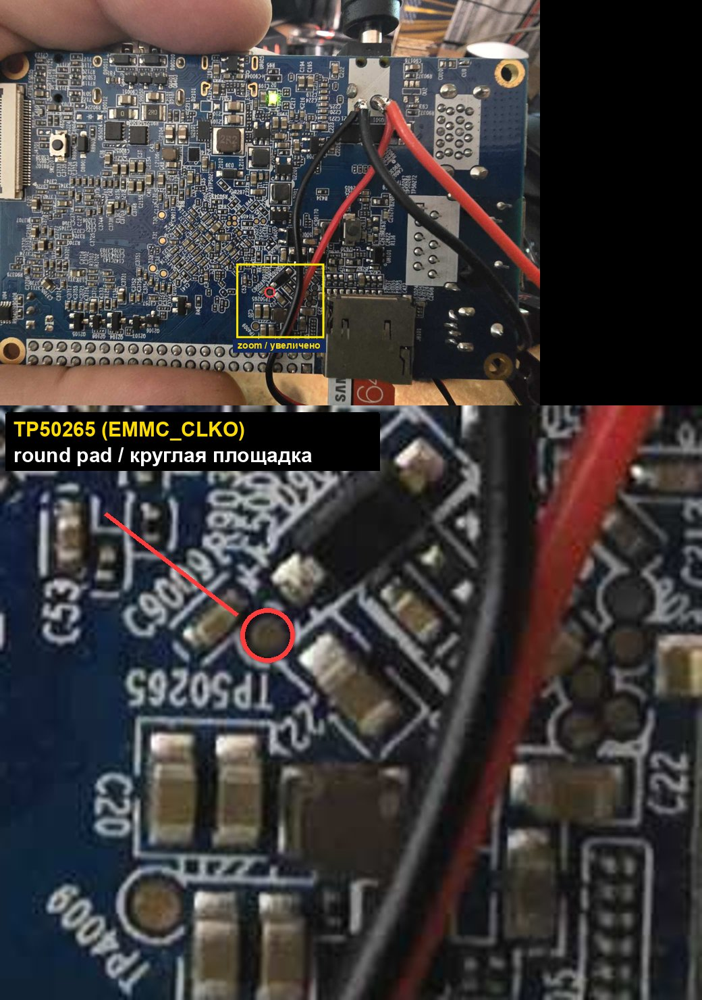

# Android 16 for Orange Pi 4 — installation guide

*Русская версия: [INSTALL.ru.md](INSTALL.ru.md)*

This guide is written for someone doing this for the very first time. Read it in order and
do the steps one by one. If something goes wrong, see
[«If something did not work»](#11-if-something-did-not-work).

**Contents**

1. [This is a beta — what that means](#1-this-is-a-beta--what-that-means)
2. [Which image to choose](#2-which-image-to-choose)
3. [What you need](#3-what-you-need)
4. [Downloading the files](#4-downloading-the-files)
5. [Backup — before you install](#5-backup--before-you-install)
6. [Installing on a memory card — the easiest way](#6-installing-on-a-memory-card--the-easiest-way)
7. [First start and setup](#7-first-start-and-setup)
8. [Installing to the built-in memory (eMMC)](#8-installing-to-the-built-in-memory-emmc)
9. [Google services: Play Store, YouTube, etc.](#9-google-services-play-store-youtube-etc)
10. [Streaming services and protected video (DRM)](#10-streaming-services-and-protected-video-drm)
11. [If something did not work](#11-if-something-did-not-work)
12. [Useful things](#12-useful-things)

---

## 1. This is a beta — what that means

The build works, but it has not been fully tested. What is known, honestly:

* **Tested:** booting, HDMI picture and sound, Wi-Fi, Bluetooth, Ethernet, USB, video,
  installing Google services from a USB stick on the TV image.
* **Not fully tested:** running at the maximum CPU speed (1.8 GHz) under long heavy load,
  installing Google services on the tablet image, and the exact files of this release
  (they are built the same way as the tested ones).

What this means for you: **first install the system on a memory card** (section 6) — you
cannot break anything with a card, you can simply take it out. Install to the built-in
memory (section 8) only once everything works from the card.

Found a bug? Report it in [Issues](https://github.com/oops1/opi4-android/issues)
(section 11 explains how to collect a report).

## 2. Which image to choose

| Image | What for | Controls |
|---|---|---|
| **TV** (`opi4-android16-tv-…`) | A TV box with the Android TV interface | remote, air mouse or keyboard |
| **Tablet** (`opi4-android16-tablet-…`) | Normal Android like on a tablet: DIY projects, experiments, GPIO, root access | mouse and keyboard |

Not sure? Take **TV**.

The images contain **no** Google services (Play Store etc.): only Google may distribute
them. You can add them yourself in a couple of minutes — section 9.

## 3. What you need

* **An Orange Pi 4 board** (the regular one, not LTS; tested on revision 1.3).
* **A 5 V / 3 A power supply** (the label says «5V ⎓ 3A»). It goes into the board's USB-C
  port (or into the round power jack, if your board has one). A 2 A phone charger or a
  power bank **will not do**: the board will freeze. Use a short, thick cable.
* **A microSD card**, 16 GB or more, preferably marked «A1» or «A2».
* **A card reader** to put the card into the computer (many laptops have one built in).
* **A computer** with Windows (Linux and macOS work too — Linux commands are given where needed).
* **An HDMI cable** and a TV or monitor.
* **Something to control it with:** a USB keyboard and mouse, an air mouse with a USB
  receiver (the most convenient for TV), or a Bluetooth remote. Infrared (ordinary) remotes
  do not work yet.
* **A heatsink, preferably with a fan**, on the processor — it gets hot.
  A 5 V fan connects to the pin header: **red wire to pin 4, black wire to pin 6**.
  Careful: the nearby pin 1 is 3.3 V, and shorting it to pin 4 can burn the board.
  Do it with the power off.
* For installing to the built-in memory (section 8): **a USB-C to USB-A cable** that
  carries data (not a «charging only» cable).

## 4. Downloading the files

1. Open the [Releases](https://github.com/oops1/opi4-android/releases) page and pick the
   topmost release.
2. At the bottom, in the **Assets** block, download the files you need. The file name
   contains `tv` or `tablet` — that is the image type (section 2):

   | File | What for |
   |---|---|
   | `…-sdcard.img.xz` | image for a memory card (section 6) — **almost everyone needs it** |
   | `…-emmc.zip` | kit for installing to the built-in memory (section 8) |
   | `….sha256` | checksums, to check that a file downloaded without errors |

3. **Checking the file (you may skip it, but better do it).** The file is big and could
   get damaged while downloading.
   * Open the folder with the downloaded file, hold **Shift** and right-click an empty
     spot → «Open PowerShell window here» (or «Open in Terminal»).
   * Type this (use your file name) and press Enter:
     ```powershell
     Get-FileHash .\opi4-android16-tv-20261116-sdcard.img.xz
     ```
   * Open the `.sha256` file in Notepad. The long string of letters and digits (Hash) must
     **match exactly** the line for that file. If it does not match, download the file again.

You do **not** need to unpack the `.img.xz` file — the writing program does that itself.

## 5. Backup — before you install

Installing **erases everything** on the place you install to:

* installing on a **card** erases everything on the card;
* installing to the **built-in memory** erases the board's old system and all its files.

### 5.1. Save your files

If the card or the board has anything you need (photos, documents, settings), copy it to
a computer or a USB stick **before** installing.

### 5.2. A full copy of the memory card (optional)

This saves the card «as is», so you can later put it back exactly as it was.

1. Download and install [Win32 Disk Imager](https://sourceforge.net/projects/win32diskimager/).
2. Put the card into the computer and start the program.
3. In **Image File**, click the folder icon, choose where to save and type a name,
   for example `card-backup.img`.
4. In **Device**, choose the drive letter of your card.
5. Click **Read** and wait until it finishes (it is slow: 10–30 minutes). The file will be
   as big as the card.

**To restore the copy:** the same, but choose the saved file and click **Write**.

**If it did not work:** right-click the program → «Run as administrator»; try another
card reader; make sure the computer's disk has enough free space (as much as the card size).

### 5.3. The old system in the built-in memory

There is no simple way to copy the built-in memory. But if it holds the original
Orange Pi system, you can always get it back: the images and the installation guide are
on the official site [orangepi.org](http://www.orangepi.org/) — the Orange Pi 4 page,
downloads section (Downloads / Official Images).

## 6. Installing on a memory card — the easiest way

1. Download and install [balenaEtcher](https://etcher.balena.io/) (Windows, macOS, Linux).
2. Put the card into the computer. If Windows offers to «format the disk», click **Cancel**.
3. Start balenaEtcher:
   * **Flash from file** → choose the `…-sdcard.img.xz` file;
   * **Select target** → choose **your card** (check the size! Do not pick a USB stick or
     a hard drive by mistake — everything on it will be erased);
   * **Flash!** — Windows asks for permission, click «Yes».
4. Wait until Etcher writes and checks the card (5–15 minutes) and shows **Flash Complete**.
5. Windows may again offer to format the disk or say it «cannot be read» — that is normal,
   click **Cancel**. Take the card out.

Linux: `xzcat …-sdcard.img.xz | sudo dd of=/dev/sdX bs=4M conv=fsync status=progress`
(`/dev/sdX` is your card, check it with `lsblk`).

**If it did not work:** if Etcher shows a write or verify error, try again, then another
card reader, then another card. More in section 11.

## 7. First start and setup

1. Put the card into the board's slot (contacts facing the board, all the way in).
2. Connect HDMI to the TV, and the keyboard/mouse or the air mouse receiver to USB.
3. Plug in the power supply. A red LED lights up on the board.
4. **The first start is long — 3–5 minutes.** The screen may stay black, then the boot
   animation appears. Do not press anything and do not switch it off. Later starts take
   less than a minute.
5. The home screen (or a setup wizard) appears.

Then:

* **Language:** Settings → System → Language.
* **Wi-Fi:** Settings → Network & Internet → choose your network, type the password.
  A USB keyboard makes typing the password easier.
* **Bluetooth remote** (TV image): Settings → Remotes & Accessories → Add accessory,
  then hold the pairing button on the remote (see the remote's manual).

Keyboard controls in the TV image: arrows — move, **Enter** — select, **Esc** — back,
**Home** — home screen.

If something is wrong (no picture, very long start, the old system started) — section 11.

## 8. Installing to the built-in memory (eMMC)

**Why:** Android runs faster from the built-in memory, and the card is free again.
**First** make sure the system works well from the card (sections 6–7).

The installation is done from a computer with the `fastboot` program. The steps below are
for Windows.

### 8.1. Preparing the computer (once)

1. Download [Android SDK Platform-Tools for Windows](https://developer.android.com/tools/releases/platform-tools)
   (the «Download SDK Platform-Tools for Windows» link) and unpack the zip — you get a
   `platform-tools` folder.
2. Download the [Google USB Driver](https://developer.android.com/studio/run/win-usb) (zip)
   and unpack it — you get a `usb_driver` folder. You need it if Windows does not find a
   driver by itself (step 8.3).

### 8.2. Preparing the files

1. Unpack `…-emmc.zip` (right-click → «Extract All»). You get a folder with
   `flash-all.bat`, `deploy-sd-for-emmc.img`, `super.img` and other files.
2. **Copy all files from the `platform-tools` folder** into this folder (next to `flash-all.bat`).
3. Write `deploy-sd-for-emmc.img` to a memory card with balenaEtcher (as in section 6, just
   choose this file). This is a special «installer» card.

### 8.3. Installing

1. Put the installer card into the board.
2. Connect the **board's USB-C port to the computer** with a data cable. If the board has
   a round power jack, plug the power supply into it. If not, the board gets its power from
   the computer through the same cable.
3. Switch the power on. The screen **stays black** — that is right: the board is waiting for
   commands from the computer.
4. Wait 20 seconds. Check that the computer sees the board:
   * right-click «Start» → **Device Manager**;
   * there should be a device called **Android Bootloader Interface** (or «Android Device»).
   * If there is a device with a **yellow triangle** («Android» or «USB download gadget»):
     right-click it → «Update driver» → «Browse my computer for drivers» → choose the
     `usb_driver` folder → «Next». If Windows asks, choose **Android Bootloader Interface**.
5. Double-click `flash-all.bat`. A black window opens and the installation starts.
6. After about a minute the window asks:
   ```
   Power the board OFF, REMOVE the SD card, power it ON again.
   ```
   Do exactly that: switch the power off (unplug the power supply, or the USB-C cable if
   the board is powered from the computer), **take the card out**, switch the power on
   again (the USB-C cable to the computer must stay connected). Wait 20 seconds and press
   any key in the black window.
7. The rest runs by itself (5–10 minutes; writing `super` is the longest part). The line
   `< waiting for any device >` means «waiting for the board» — just wait.
8. When **Finished** appears, the board restarts into Android by itself. The first start
   takes 3–5 minutes. Done! You can close the window.

Linux: the same steps, but run `./flash-all.sh` in the folder instead of `flash-all.bat`
(you need `fastboot`: `sudo apt install fastboot`).

**If it did not work** — section 11, the eMMC items. You cannot break the board this way:
the installation can always be started again.

## 9. Google services: Play Store, YouTube, etc.

We use the free **MindTheGapps** package for Android 16 (arm64).

### 9.1. Downloading the package

* for the **TV** image — `MindTheGapps-16.0.0-arm64-ATV-full-<date>.zip` from
  <https://github.com/MindTheGapps/16.0.0-arm64-ATV/releases>;
* for the **tablet** image — `MindTheGapps-16.0.0-arm64-<date>.zip` from
  <https://github.com/MindTheGapps/16.0.0-arm64/releases>.

Take the newest release, the file in the Assets block. Download only from these pages
(or via the links on <https://wiki.lineageos.org/gapps/>).

### 9.2. Installing from a USB stick (no root needed)

Do this **right after the first start**, before installing your own apps.

1. Take an ordinary USB stick (FAT32 or exFAT — as sold). Copy the zip **as is, without
   unpacking it**, to the root of the stick (not into a folder).
   The TV image needs the ATV package, the tablet image the regular one. Do not mix them up!
2. Plug the stick into any USB port of the **running** board.
3. Wait 1–3 minutes. The board finds the package, prepares the services and **restarts by
   itself**. The first start after that is longer than usual.
4. The Google setup wizard starts: connect to the network and sign in to your Google
   account. You can take the stick out. If the wizard shows a black screen for more than
   a minute, press any button on the remote or keyboard.

Good to know:

* While installing, Android resets app permissions once — apps installed earlier will ask
  for their permissions again.
* **To remove Google services:** put an empty file named `REMOVE-GAPPS` (no extension — in
  Notepad choose «All files» and type `REMOVE-GAPPS`) on the stick and plug it into the
  board — it removes the package and restarts.
* **A factory reset also removes Google services** — after a reset, plug in the stick with
  the package again.

**If it did not work:** check that the package is the right one (ATV for TV), that it lies
in the root of the stick and is not unpacked; unplug and plug the stick again; try another
USB port (on some boards the upper blue port gives no power) or another stick.

### 9.3. Registering the board with Google («Device is not certified»)

The board has not gone through Google certification, so the Play Store may say «Device is
not certified», and some apps will not install. Google lets you register such a device by
hand (up to 100 devices per account).

1. Turn on debugging on the board: Settings → About → press «Build number» **7 times**
   («You are now a developer» appears). Then Settings → Developer options → turn on
   «USB debugging».
2. On the computer open the `platform-tools` folder (section 8.1), type `cmd` in the
   Explorer address bar and press Enter — a command window opens.
3. Connect the board to the computer with a USB-C cable (or over the network:
   `adb connect <board IP address>`, the address is in Settings → Network). The board's
   screen asks «Allow USB debugging?» — tick «Always» and press «Allow».
4. Type the command:
   ```
   adb shell content query --uri content://com.google.android.gsf.gservices --projection android_id
   ```
   Copy the number after `android_id=`.
5. Open <https://www.google.com/android/uncertified/>, sign in to **the same Google
   account** as on the board, paste the number, tick «I'm not a robot» and press «Register».
6. Wait 10–30 minutes. Then on the board: Settings → Apps → Google Play Store →
   «Clear storage», the same for «Google Play services». Restart the board.

## 10. Streaming services and protected video (DRM)

Streaming services (Netflix, Prime Video, Disney+ and similar) protect their films with
**Widevine**. It is closed Google software: the images do not contain it, MindTheGapps does
not add it, and you cannot install it yourself for now.

* **Works:** YouTube, the browser, IPTV players, Kodi, VLC, video from a USB stick or the network.
* **Does not work:** protected films and series in streaming apps — you get a black
  screen, a playback error or «device not supported»; the Play Store may refuse to install
  some of those apps.

Even with Widevine the board would only get the simplest, software protection level (L3):
most services would show video in low quality or not at all.

## 11. If something did not work

Do not worry: it is almost impossible to damage the board by installing. The card can
always be written again, and the eMMC installation can always be started again.

### The board does not start, no picture

* **No LED is on** — no power. Check the power supply and the cable, try another socket.
* **The LED is on, the TV says «No signal»** — wait 5 minutes (the first start is long).
  Check that the TV is switched to the HDMI input the cable is in. Try another cable or
  HDMI port.
* **Nothing after five minutes, or the board restarts by itself** — almost always a weak
  power supply or a bad contact in the plug. You need 5 V / 3 A and a short cable.
* **Starting takes more than 10 minutes** — write the card again (section 6). If that does
  not help, use another card (cheap cards are often faulty; you can test one with H2testw).

### The old system (or a «foreign» screen) started instead of Android

The board **starts from the built-in memory (eMMC) first** and from the card only if the
built-in memory is empty. So the built-in memory already holds a system, and you have to
«bypass» or erase it. This is also needed for installing to the built-in memory (section 8):
the installer card will not start either while the built-in memory holds a system.

1. **If the built-in memory already holds this same build** (Android 16), erase its
   bootloader — then the board starts from the card again:
   * turn on «USB debugging» (section 9.3, steps 1–3);
   * in the command window type `adb reboot bootloader` — the screen goes dark;
   * after 10 seconds type `fastboot erase bootloader`, then switch the power off;
   * put the card in and switch the board on.
2. **The universal way — «bypass» the built-in memory.** You need a thin wire or metal
   tweezers and a steady hand:
   * switch the power off, put in the card (the normal one from section 6 or the installer
     card from section 8);
   * find the round pad **TP50265** on the **bottom** side of the board (photo below);
   * connect it with the wire to **ground** — for example to pin **6** of the header (or to
     the metal shell of a USB connector) — and **while holding the connection**, switch the
     power on;
   * after 3 seconds remove the wire. The board starts from the card.

   

   Touch **only** this pad and ground. Never touch the 3.3 V and 5 V header pins (1, 2, 4)
   — a short circuit can burn the board.

### Installing to the built-in memory (section 8)

* **`No fastboot device`, or the board is not in Device Manager:**
  * check the cable: many USB-C cables are «charging only» — take another one;
  * try another USB port of the computer (better one on the back);
  * install the driver (section 8.3, step 4);
  * check that the card holds `deploy-sd-for-emmc.img`;
  * if the board started Android or an old system instead of waiting with a black
    screen — see «The old system started instead of Android» above.
* **The window says `FAILED`** — run `flash-all.bat` again. If the error came after the
  «Power the board OFF…» step, you do not need the card: the board starts in install mode
  by itself (black screen) — just run `flash-all.bat` again.
* **`'fastboot' is not recognized as an internal or external command`** — you did not copy
  the files from `platform-tools` into the folder with `flash-all.bat` (section 8.2, step 2).
* **Android does not start after the installation** (stuck on the animation or restarting):
  switch the power off and on 3–4 times. After several failed attempts the board goes into
  install mode by itself (black screen) — run `flash-all.bat` again. If that does not help,
  use way 2 from «The old system started instead of Android», then install again.

### Using the system

* **Freezes or restarts under load (games, 4K video)** — the power supply (you need
  5 V / 3 A) or overheating (you need a heatsink, preferably with a fan).
* **Wi-Fi does not see a 5 GHz network** — Settings → Network → choose your country.
* **The mouse does not work in the TV setup wizard** — use the keyboard (arrows, Enter) or
  the remote.
* **No sound** — sound goes over HDMI; check the TV volume and Settings → Sound.
* **A streaming app shows a black screen or an error** — that is Widevine protection, section 10.
* **Google services do not install** — section 9.2, «If it did not work».

### Putting everything back

* **Card:** write the saved copy back to it (section 5.2) or simply format it.
* **Built-in memory with the original system:** install it again using the guide from the
  Orange Pi site (section 5.3).

### How to report a bug

Write in [Issues](https://github.com/oops1/opi4-android/issues): which image (TV or tablet,
the date in the file name), where you installed it (card or eMMC), which power supply, what
you did and what you saw. Logs help a lot — turn on «USB debugging» (section 9.3) and run
in the command window:
```
adb logcat -d > log.txt
adb shell dmesg > dmesg.txt
```
The files `log.txt` and `dmesg.txt` appear in the `platform-tools` folder — attach them to
your report.

## 12. Useful things

* **Root (tablet image only):** `adb root`, then `adb shell`.
* **CPU temperature:** `adb shell cat /sys/class/thermal/thermal_zone0/temp`
  (in thousandths of °C: 65000 = 65 °C).
* **GPIO, I2C, SPI, PWM** on the header are available to apps: `/dev/gpiochip*`,
  `/dev/i2c-*`, `/dev/spidev1.0`, `/sys/class/pwm/pwmchip1/pwm0` (pin 7).
* **Updating:** a new release is installed the same way as the first one. All data is
  erased — save what you need beforehand (section 5).

Source code and build: <https://github.com/oops1/opi4-android>.
