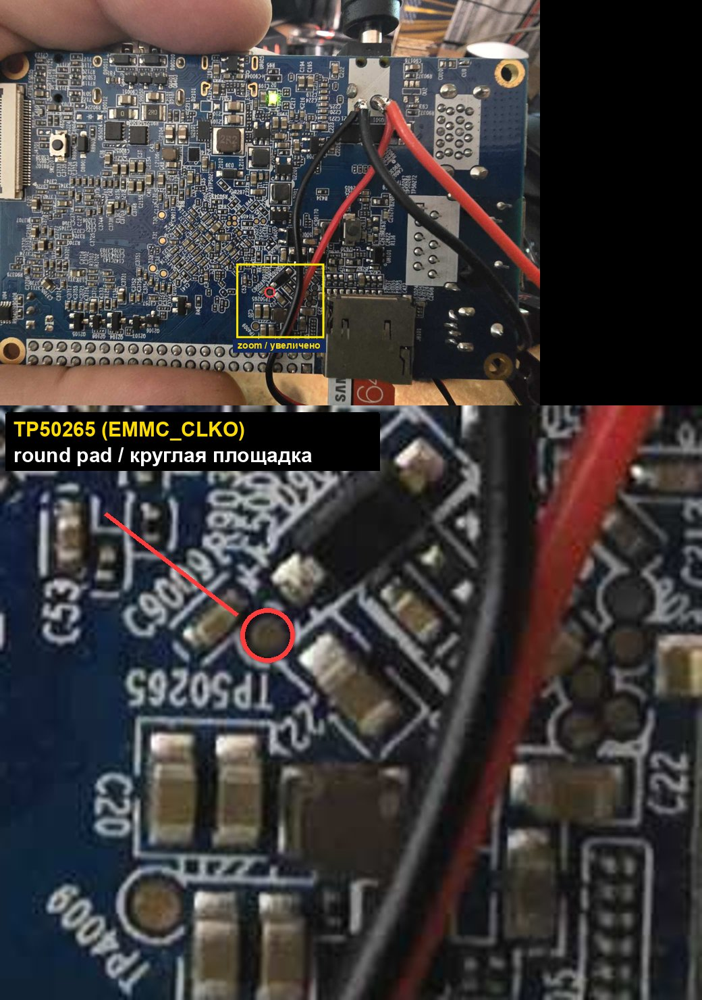

# Android 16 для Orange Pi 4 — инструкция по установке

*English version: [INSTALL.en.md](INSTALL.en.md)*

Эта инструкция написана так, чтобы справился человек, который делает такое в первый раз.
Читайте по порядку и выполняйте шаги один за другим. Если что-то пошло не так —
загляните в раздел [«Если что-то не получилось»](#11-если-что-то-не-получилось).

**Содержание**

1. [Это бета-версия — что это значит](#1-это-бета-версия--что-это-значит)
2. [Какой образ выбрать](#2-какой-образ-выбрать)
3. [Что понадобится](#3-что-понадобится)
4. [Скачиваем файлы](#4-скачиваем-файлы)
5. [Резервная копия (бэкап) — до установки](#5-резервная-копия-бэкап--до-установки)
6. [Установка на карту памяти — самый простой способ](#6-установка-на-карту-памяти--самый-простой-способ)
7. [Первое включение и настройка](#7-первое-включение-и-настройка)
8. [Установка во встроенную память (eMMC)](#8-установка-во-встроенную-память-emmc)
9. [Сервисы Google: Play Маркет, YouTube и т. д.](#9-сервисы-google-play-маркет-youtube-и-т-д)
10. [Онлайн-кинотеатры и защищённое видео (DRM)](#10-онлайн-кинотеатры-и-защищённое-видео-drm)
11. [Если что-то не получилось](#11-если-что-то-не-получилось)
12. [Полезное](#12-полезное)

---

## 1. Это бета-версия — что это значит

Сборка работает, но проверена не полностью. Честно о том, что известно:

* **Проверено:** загрузка, изображение и звук по HDMI, Wi-Fi, Bluetooth, Ethernet, USB,
  видео, установка сервисов Google с флешки на TV-образ.
* **Не проверено до конца:** работа на максимальной частоте процессора (1,8 ГГц) под
  долгой нагрузкой, установка сервисов Google на планшетный образ, сами файлы этого
  выпуска (они собраны тем же способом, что и проверенные).

Что это значит для вас: **сначала поставьте систему на карту памяти** (раздел 6) — с картой
ничего нельзя сломать, её можно просто вынуть. Во встроенную память (раздел 8) ставьте,
только когда с карты всё работает.

Нашли ошибку — напишите в [Issues](https://github.com/oops1/opi4-android/issues)
(как собрать отчёт — в разделе 11).

## 2. Какой образ выбрать

| Образ | Для чего | Управление |
|---|---|---|
| **TV** (`opi4-android16-tv-…`) | Приставка к телевизору, интерфейс как на Android TV | пульт, аэромышь или клавиатура |
| **Планшет** (`opi4-android16-tablet-…`) | Обычный Android как на планшете: поделки, эксперименты, GPIO, root-доступ | мышь и клавиатура |

Не знаете, что выбрать — берите **TV**.

В образах **нет** сервисов Google (Play Маркет и т. д.): распространять их может только
Google. Их можно поставить самому за пару минут — раздел 9.

## 3. Что понадобится

* **Плата Orange Pi 4** (обычная, не LTS; проверено на ревизии 1.3).
* **Блок питания 5 В / 3 А** (написано на блоке: «5V ⎓ 3A»). Подключается в разъём
  USB-C платы (или в круглый разъём питания, если он есть на вашей плате).
  Зарядка от телефона на 2 А или повербанк **не подойдут**: плата будет зависать.
  Кабель — короткий и толстый.
* **Карта памяти microSD** от 16 ГБ, лучше с надписью «A1» или «A2».
* **Картридер** — чтобы вставить карту в компьютер (во многих ноутбуках он встроен).
* **Компьютер** с Windows (подойдут и Linux, и macOS — команды для Linux даны там, где нужны).
* **Кабель HDMI** и телевизор или монитор.
* **Чем управлять:** USB-клавиатура и мышь, или аэромышь с USB-приёмником (удобнее всего
  для TV), или Bluetooth-пульт. ИК-пульт (обычный, «инфракрасный») пока не работает.
* **Радиатор, лучше с вентилятором** на процессор — он сильно греется.
  Вентилятор на 5 В подключается к гребёнке: **красный провод — к контакту 4, чёрный — к
  контакту 6**. Внимательно: соседний контакт 1 — это 3,3 В, если замкнуть его с
  контактом 4, плата может сгореть. Делайте это при выключенном питании.
* Для установки во встроенную память (раздел 8): **кабель USB-C — USB-A**, который
  передаёт данные (не «только зарядка»).

## 4. Скачиваем файлы

1. Откройте страницу [Releases](https://github.com/oops1/opi4-android/releases) и
   выберите самый верхний выпуск.
2. Внизу, в блоке **Assets**, скачайте нужные файлы. В имени файла есть `tv` или `tablet`
   — это тип образа (раздел 2):

   | Файл | Зачем |
   |---|---|
   | `…-sdcard.img.xz` | образ для карты памяти (раздел 6) — **нужен почти всем** |
   | `…-emmc.zip` | набор для установки во встроенную память (раздел 8) |
   | `….sha256` | контрольные суммы, чтобы проверить, что файл скачался без ошибок |

3. **Проверка файла (можно пропустить, но лучше сделать).** Файл большой, и при
   скачивании он мог испортиться.
   * Откройте папку со скачанным файлом, нажмите на пустом месте правой кнопкой мыши
     с зажатой клавишей **Shift** → «Открыть окно PowerShell здесь» (или «Открыть в терминале»).
   * Введите (вместо имени подставьте своё) и нажмите Enter:
     ```powershell
     Get-FileHash .\opi4-android16-tv-20261116-sdcard.img.xz
     ```
   * Откройте файл `.sha256` Блокнотом. Длинная строка из букв и цифр (Hash) должна
     **полностью совпадать** со строкой для этого файла. Не совпадает — скачайте файл заново.

Распаковывать `.img.xz` **не нужно** — программа записи сделает это сама.

## 5. Резервная копия (бэкап) — до установки

Установка **стирает всё**, что было на том, куда вы ставите систему:

* установка на **карту** стирает всё на карте;
* установка во **встроенную память** стирает старую систему платы и все файлы в ней.

### 5.1. Сохраните свои файлы

Если на карте или на плате есть что-то нужное (фото, документы, настройки) — скопируйте
это на компьютер или флешку **до** установки.

### 5.2. Копия карты памяти целиком (по желанию)

Так можно сохранить карту «как есть» и потом вернуть её в точно такое же состояние.

1. Скачайте и установите [Win32 Disk Imager](https://sourceforge.net/projects/win32diskimager/).
2. Вставьте карту в компьютер и запустите программу.
3. В поле **Image File** нажмите на значок папки, выберите, куда сохранить, и введите имя,
   например `backup-karta.img`.
4. В поле **Device** выберите букву диска вашей карты.
5. Нажмите **Read** и дождитесь конца (это долго: 10–30 минут). Файл будет размером с карту.

**Вернуть копию:** то же самое, но выберите сохранённый файл и нажмите **Write**.

**Если не получилось:** запустите программу правой кнопкой → «Запуск от имени
администратора»; попробуйте другой картридер; убедитесь, что на диске компьютера
хватает места (столько же, сколько объём карты).

### 5.3. Старая система во встроенной памяти

Сделать копию встроенной памяти простым способом нельзя. Но если там стоит заводская
система Orange Pi, её всегда можно вернуть: образы и инструкция по установке есть на
официальном сайте [orangepi.org](http://www.orangepi.org/) — страница платы Orange Pi 4,
раздел загрузок (Downloads / Official Images).

## 6. Установка на карту памяти — самый простой способ

1. Скачайте и установите [balenaEtcher](https://etcher.balena.io/) (Windows, macOS, Linux).
2. Вставьте карту в компьютер. Если Windows предлагает «отформатировать диск» —
   нажмите **Отмена**.
3. Запустите balenaEtcher:
   * **Flash from file** → выберите файл `…-sdcard.img.xz`;
   * **Select target** → выберите **вашу карту** (смотрите на размер! Не выберите
     по ошибке флешку или жёсткий диск — всё на нём сотрётся);
   * **Flash!** — Windows спросит разрешение, нажмите «Да».
4. Подождите, пока Etcher запишет и проверит карту (5–15 минут) и напишет **Flash Complete**.
5. Windows может снова предложить отформатировать диск или сказать, что он «не читается»
   — это нормально, нажмите **Отмена**. Выньте карту.

Linux: `xzcat …-sdcard.img.xz | sudo dd of=/dev/sdX bs=4M conv=fsync status=progress`
(`/dev/sdX` — ваша карта, проверьте командой `lsblk`).

**Если не получилось:** Etcher пишет ошибку записи или проверки — попробуйте ещё раз,
затем другой картридер, затем другую карту. Подробнее — раздел 11.

## 7. Первое включение и настройка

1. Вставьте карту в слот платы (контактами к плате, до щелчка или до упора).
2. Подключите HDMI к телевизору, клавиатуру/мышь или приёмник аэромыши — в USB.
3. Подключите блок питания. На плате загорится красный светодиод.
4. **Первое включение долгое — 3–5 минут.** Экран может быть чёрным, потом появится
   анимация загрузки. Ничего не нажимайте и не выключайте. Следующие включения — меньше минуты.
5. Появится главный экран (или мастер настройки).

Дальше:

* **Язык:** Настройки → Система → Язык (System → Language) → Русский.
* **Wi-Fi:** Настройки → Сеть и Интернет → выберите свою сеть, введите пароль.
  Пароль удобнее вводить с USB-клавиатуры.
* **Bluetooth-пульт** (TV-образ): Настройки → Пульты и аксессуары → Добавить
  устройство, на пульте зажмите кнопку сопряжения (смотрите инструкцию к пульту).

Управление с клавиатуры в TV-образе: стрелки — перемещение, **Enter** — выбрать,
**Esc** — назад, **Home** — на главный экран.

Если что-то не так (нет изображения, долго грузится, загрузилась старая система) — раздел 11.

## 8. Установка во встроенную память (eMMC)

**Зачем:** из встроенной памяти Android работает быстрее, а карта освобождается.
**Сначала** убедитесь, что система нормально работает с карты (разделы 6–7).

Установка идёт с компьютера через программу `fastboot`. Ниже — для Windows.

### 8.1. Подготовка компьютера (один раз)

1. Скачайте [Android SDK Platform-Tools для Windows](https://developer.android.com/tools/releases/platform-tools)
   (ссылка «Download SDK Platform-Tools for Windows»), распакуйте zip — получится папка
   `platform-tools`.
2. Скачайте [Google USB Driver](https://developer.android.com/studio/run/win-usb)
   (zip) и распакуйте — получится папка `usb_driver`. Он понадобится, если Windows сама не
   найдёт драйвер (шаг 8.3).

### 8.2. Подготовка файлов

1. Распакуйте `…-emmc.zip` (правой кнопкой → «Извлечь всё»). Получится папка с файлами
   `flash-all.bat`, `deploy-sd-for-emmc.img`, `super.img` и другими.
2. **Скопируйте все файлы из папки `platform-tools`** в эту папку (рядом с `flash-all.bat`).
3. Запишите файл `deploy-sd-for-emmc.img` на карту памяти программой balenaEtcher
   (как в разделе 6, только выберите этот файл). Это специальная «установочная» карта.

### 8.3. Установка

1. Вставьте установочную карту в плату.
2. Соедините **USB-C платы с компьютером** кабелем с данными. Если у платы есть
   круглый разъём питания — подключите блок питания в него. Если нет — плата получит
   питание от компьютера по этому же кабелю.
3. Включите питание. Экран **останется чёрным** — так и надо: плата ждёт команд от компьютера.
4. Подождите 20 секунд. Проверьте, что компьютер видит плату:
   * нажмите правой кнопкой на «Пуск» → **Диспетчер устройств**;
   * должно появиться устройство **Android Bootloader Interface** (или «Android Device»).
   * Если там устройство с **жёлтым треугольником** («Android» или «USB download gadget»):
     правой кнопкой → «Обновить драйвер» → «Найти драйверы на этом компьютере» →
     укажите папку `usb_driver` → «Далее». Если Windows спросит — выберите
     **Android Bootloader Interface**.
5. Дважды щёлкните `flash-all.bat`. Откроется чёрное окно, пойдёт установка.
6. Через минуту окно попросит:
   ```
   Power the board OFF, REMOVE the SD card, power it ON again.
   ```
   Сделайте так: выключите питание (выньте блок питания, а если плата питается
   от компьютера — выньте кабель USB-C), **выньте карту**, снова включите питание
   (кабель USB-C к компьютеру должен остаться подключён). Подождите 20 секунд и
   нажмите любую клавишу в чёрном окне.
7. Дальше всё идёт само (5–10 минут — самая долгая часть, запись `super`). Строчка
   `< waiting for any device >` значит «жду плату» — просто подождите.
8. Когда появится **Finished**, плата сама перезагрузится в Android. Первое включение —
   3–5 минут. Готово! Окно можно закрыть.

Linux: те же шаги, но вместо `flash-all.bat` запустите в папке `./flash-all.sh`
(нужен `fastboot`: `sudo apt install fastboot`).

**Если не получилось** — раздел 11, пункты про eMMC. Плату этим не сломать: установку
всегда можно запустить заново.

## 9. Сервисы Google: Play Маркет, YouTube и т. д.

Используется бесплатный пакет **MindTheGapps** для Android 16 (arm64).

### 9.1. Скачиваем пакет

* для **TV**-образа — файл `MindTheGapps-16.0.0-arm64-ATV-full-<дата>.zip` со страницы
  <https://github.com/MindTheGapps/16.0.0-arm64-ATV/releases>;
* для **планшетного** — `MindTheGapps-16.0.0-arm64-<дата>.zip` со страницы
  <https://github.com/MindTheGapps/16.0.0-arm64/releases>.

Берите самый свежий выпуск, файл в блоке Assets. Качайте только с этих страниц
(или по ссылкам с <https://wiki.lineageos.org/gapps/>).

### 9.2. Устанавливаем с флешки (root не нужен)

Делайте это **сразу после первого включения**, до установки своих приложений.

1. Возьмите обычную USB-флешку (FAT32 или exFAT — как продаётся). Скопируйте zip
   **как есть, не распаковывая** в корень флешки (не в папку).
   TV-образу нужен ATV-архив, планшетному — обычный. Не перепутайте!
2. Вставьте флешку в любой USB-порт **включённой** платы.
3. Ждите 1–3 минуты. Плата сама найдёт архив, подготовит сервисы и **сама
   перезагрузится**. Первая загрузка после этого дольше обычной.
4. Запустится мастер настройки Google: подключите сеть, войдите в аккаунт Google.
   Флешку можно вынуть. Если мастер показывает чёрный экран дольше минуты — нажмите
   любую кнопку на пульте или клавиатуре.

Важно знать:

* При установке Android один раз сбрасывает разрешения приложений — приложения,
  поставленные раньше, спросят разрешения заново.
* **Удалить сервисы Google:** положите на флешку пустой файл с именем `REMOVE-GAPPS`
  (без расширения — в Блокноте сохраните как «Все файлы», имя `REMOVE-GAPPS`) и
  вставьте её в плату — она удалит пакет и перезагрузится.
* **Сброс к заводским настройкам удаляет и сервисы Google** — после сброса вставьте
  флешку с архивом снова.

**Если не получилось:** проверьте, что архив правильный (ATV для TV), лежит в корне
флешки и не распакован; выньте и вставьте флешку снова; попробуйте другой USB-порт
(у некоторых плат верхний синий порт не даёт питание) или другую флешку.

### 9.3. Регистрация платы в Google («Устройство не сертифицировано»)

Плата не проходила сертификацию Google, поэтому Play Маркет может написать
«Устройство не сертифицировано», и часть приложений не установится. Google разрешает
зарегистрировать такое устройство вручную (до 100 устройств на аккаунт).

1. Включите отладку на плате: Настройки → Об устройстве → **7 раз** нажмите «Номер
   сборки» (появится «Вы стали разработчиком»). Затем Настройки → Для разработчиков →
   включите «Отладка по USB».
2. На компьютере откройте папку `platform-tools` (раздел 8.1), в адресной строке
   Проводника наберите `cmd` и нажмите Enter — откроется окно команд.
3. Подключите плату к компьютеру кабелем USB-C (или по сети:
   `adb connect <IP-адрес платы>`, адрес — в Настройки → Сеть). На экране платы
   появится вопрос «Разрешить отладку?» — отметьте «Всегда» и нажмите «Разрешить».
4. Введите команду:
   ```
   adb shell content query --uri content://com.google.android.gsf.gservices --projection android_id
   ```
   Скопируйте число после `android_id=`.
5. Откройте <https://www.google.com/android/uncertified/>, войдите в **тот же аккаунт
   Google**, что на плате, вставьте число, отметьте «Я не робот» и нажмите «Зарегистрировать».
6. Подождите 10–30 минут. Затем на плате: Настройки → Приложения → Google Play Маркет →
   «Очистить хранилище», то же для «Сервисы Google Play». Перезагрузите плату.

## 10. Онлайн-кинотеатры и защищённое видео (DRM)

Онлайн-кинотеатры (Кинопоиск, Okko, Wink, Иви, START, Netflix, Prime Video и т. п.)
защищают фильмы системой **Widevine**. Это закрытая программа Google: в образах её нет,
пакет MindTheGapps её тоже не добавляет, и поставить её самостоятельно пока нельзя.

* **Работает:** YouTube, браузер, IPTV-плееры, Kodi, VLC, видео с флешки и из сети.
* **Не работает:** защищённые фильмы и сериалы в онлайн-кинотеатрах — будет чёрный
  экран, ошибка воспроизведения или «устройство не поддерживается»; некоторые такие
  приложения Play Маркет не даст установить.

Даже с Widevine у платы был бы только самый простой, программный уровень защиты (L3):
большинство сервисов показывали бы видео в низком качестве или не показывали вовсе.

## 11. Если что-то не получилось

Не волнуйтесь: плату почти невозможно испортить установкой. Карту всегда можно
перезаписать, а установку в eMMC — запустить заново.

### Плата не включается, нет изображения

* **Не горит ни один светодиод** — нет питания. Проверьте блок питания и кабель,
  попробуйте другой разъём или розетку.
* **Светодиод горит, экран пишет «Нет сигнала»** — подождите 5 минут (первое
  включение долгое). Проверьте, что телевизор переключён на тот вход HDMI, куда
  вставлен кабель. Попробуйте другой кабель или порт HDMI.
* **Пять минут — ничего, или плата перезагружается сама по себе** — почти всегда
  слабый блок питания или плохой контакт в разъёме. Нужен 5 В / 3 А и короткий кабель.
* **Загрузка дольше 10 минут** — перезапишите карту (раздел 6). Не помогло — возьмите
  другую карту (дешёвые карты часто бракованные; проверить можно программой H2testw).

### Вместо Android загрузилась старая система (или «чужой» экран)

Плата **сначала загружается со встроенной памяти (eMMC)** и только если там пусто —
с карты. Значит, во встроенной памяти уже есть система, и её нужно «обойти» или стереть.
Это нужно и для установки во встроенную память (раздел 8): установочная карта тоже не
запустится, пока во встроенной памяти есть система.

1. **Если во встроенной памяти уже стоит эта же сборка** (Android 16), сотрите её
   загрузчик — и плата снова будет грузиться с карты:
   * включите «Отладку по USB» (раздел 9.3, шаги 1–3);
   * в окне команд введите `adb reboot bootloader` — экран погаснет;
   * через 10 секунд введите `fastboot erase bootloader`, затем выключите питание;
   * вставьте карту и включите плату.
2. **Универсальный способ — «обойти» встроенную память.** Нужен тонкий провод или
   пинцет (металлический) и аккуратность:
   * выключите питание, вставьте карту (обычную из раздела 6 или установочную из раздела 8);
   * найдите на **нижней** стороне платы круглую площадку **TP50265** (фото ниже);
   * соедините её проводком с **землёй** — например, с контактом **6** гребёнки (или
     с металлическим корпусом разъёма USB) — и, **держа соединение**, включите питание;
   * через 3 секунды уберите проводок. Плата загрузится с карты.

   

   Касайтесь **только** этой площадки и земли. Ни в коем случае не трогайте контакты
   гребёнки с 3,3 В и 5 В (1, 2, 4) — короткое замыкание может сжечь плату.

### Установка во встроенную память (раздел 8)

* **`No fastboot device` или в Диспетчере устройств нет платы:**
  * проверьте кабель: многие кабели USB-C «только для зарядки» — возьмите другой;
  * попробуйте другой USB-порт компьютера (лучше на задней стенке);
  * поставьте драйвер (раздел 8.3, шаг 4);
  * проверьте, что на карту записан именно `deploy-sd-for-emmc.img`;
  * если плата загрузила Android или старую систему, а не ждёт с чёрным экраном —
    смотрите «Вместо Android загрузилась старая система» выше.
* **Окно пишет `FAILED`** — запустите `flash-all.bat` ещё раз. Если ошибка была после
  шага «Power the board OFF…», карту вставлять не нужно: плата и так запустится в режиме
  установки (чёрный экран) — просто снова запустите `flash-all.bat`.
* **`'fastboot' не является внутренней или внешней командой`** — вы не скопировали
  файлы из `platform-tools` в папку с `flash-all.bat` (раздел 8.2, шаг 2).
* **После установки Android не запускается** (зависает на анимации или перезагружается):
  выключите и включите питание 3–4 раза. После нескольких неудачных попыток плата сама
  переходит в режим установки (чёрный экран) — запустите `flash-all.bat` ещё раз.
  Не помогло — способ 2 из раздела «Вместо Android загрузилась старая система», затем
  установка заново.

### Работа системы

* **Зависает или перезагружается под нагрузкой (игры, видео 4K)** — блок питания
  (нужен 5 В / 3 А) или перегрев (нужен радиатор, лучше с вентилятором).
* **Wi-Fi не видит сеть 5 ГГц** — Настройки → Сеть → выберите страну (RU или вашу).
* **Мышь не работает в мастере настройки на TV** — пользуйтесь клавиатурой (стрелки,
  Enter) или пультом.
* **Нет звука** — звук идёт по HDMI; проверьте громкость телевизора и Настройки → Звук.
* **Онлайн-кинотеатр — чёрный экран или ошибка** — это защита Widevine, раздел 10.
* **Сервисы Google не ставятся** — раздел 9.2, «Если не получилось».

### Вернуть всё как было

* **Карта:** запишите на неё сохранённую копию (раздел 5.2) или просто отформатируйте.
* **Встроенная память с заводской системой:** установите её заново по инструкции с
  сайта Orange Pi (раздел 5.3).

### Как сообщить об ошибке

Напишите в [Issues](https://github.com/oops1/opi4-android/issues): какой образ (TV или
планшет, дата в имени файла), куда ставили (карта или eMMC), какой блок питания, что
делали и что увидели. Очень помогут логи — включите «Отладку по USB» (раздел 9.3) и
выполните в окне команд:
```
adb logcat -d > log.txt
adb shell dmesg > dmesg.txt
```
Файлы `log.txt` и `dmesg.txt` появятся в папке `platform-tools` — приложите их к сообщению.

## 12. Полезное

* **Root (только планшетный образ):** `adb root`, затем `adb shell`.
* **Температура процессора:** `adb shell cat /sys/class/thermal/thermal_zone0/temp`
  (в тысячных долях °C: 65000 = 65 °C).
* **GPIO, I2C, SPI, PWM** на гребёнке доступны приложениям: `/dev/gpiochip*`,
  `/dev/i2c-*`, `/dev/spidev1.0`, `/sys/class/pwm/pwmchip1/pwm0` (контакт 7).
* **Обновление:** новый выпуск ставится так же, как первый. Все данные при этом
  стираются — сохраните нужное заранее (раздел 5).

Исходный код и сборка: <https://github.com/oops1/opi4-android>.
