# Cases and fan mounts for the Orange Pi 4 (RK3399, v1.3)

*Русская версия: [README.md](README.md)*

A 3D-printable case for a **30×30** or **40×40 mm** fan, plus fan mounts without a case.
Parametric OpenSCAD models and ready STL files.

> **Status: beta.** The fit template and the base have been printed and checked on a real
> board (holes and connectors match). The lids, the header cover and the 40 mm mounts of the
> current version have not been printed yet. Print the fit template before the case (section 1).

A 30 mm fan adapter for the heatsink without a case is in [../fan-mount](../fan-mount).

| File | What it is |
|------|------------|
| `opi4_board.scad` | board model: size, holes, connectors, SoC, heatsink, pin header. **All uncertain dimensions are parameters at the top of the file** |
| `opi4_case_lib.scad` | shared case code: base, lid, fit template |
| `case_30.scad` | case for a 30×30 fan |
| `case_40.scad` | case for a 40×40 fan (5 V, for full clocks) |
| `fan_mount_40.scad` | 40×40 mount without a case, 2 variants: on the heatsink and on the board holes |
| `gpio_cover.scad` | cover for the GPIO header opening (fits both lids) |
| `check_fit.scad` | check that no part touches the board model |
| `render.sh` | rebuild all STL and PNG files |
| `stl/` | ready STL files, already oriented for printing |
| `png/` | previews and assembly pictures |

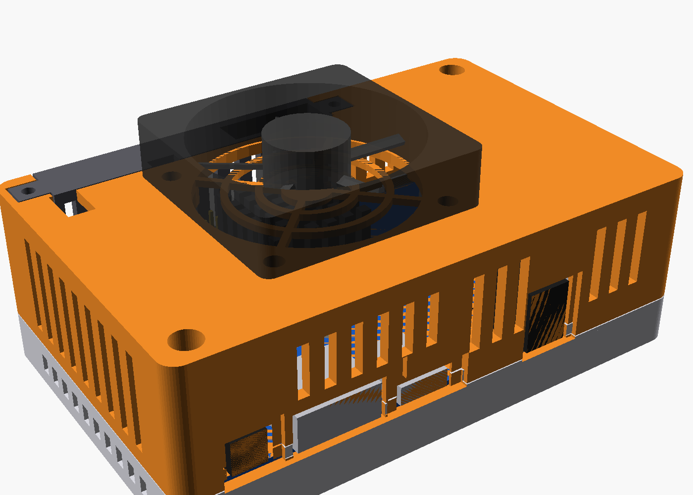

## 1. What to print

| Variant | Parts |
|---------|-------|
| **Case for a 40 mm fan** | `stl/case_base.stl` + `stl/case40_lid.stl` |
| **Case for a 30 mm fan** | `stl/case_base.stl` + `stl/case30_lid.stl` |
| **40 mm mount on the heatsink** (no case) | heatsink sits straight, sides along the board edges: `stl/fan_mount_40_heatsink.stl` (0.20 mm clearance) or `_loose` (0.35 mm); heatsink turned 45° together with the SoC: `stl/fan_mount_40_heatsink_rot45.stl` or `_rot45_loose` |
| **40 mm mount on the board holes** (no case) | `stl/fan_mount_40_bridge.stl` |
| **GPIO header cover** (for either lid) | `stl/gpio_cover.stl` — with a window for wires on pins 1–14; `stl/gpio_cover_solid.stl` — closed |
| **First — the fit template** | `stl/fit_template.stl` (~10 min, 4 g) |

Both cases share the same base: print one base and swap lids.

Weight (PETG/PLA): base ≈ 17 g, lid ≈ 21 g, cover ≈ 3 g, mount ≈ 6–8 g.

### Print the fit template first

The dimensions were taken from official photos, accuracy about ±0.5 mm. To avoid spending
4 hours on a case blindly, print `fit_template.stl`: a frame along the board outline, four
posts with pins and tabs opposite each connector.

1. Put the board on the template: the pins must go into the mounting holes without force.
2. The tabs on the edges must sit exactly under the connectors: audio, HDMI, USB-C, DC at
   the front; USB stack, Ethernet, USB2 on the right; microSD at the back.
3. The cross and the 20×20 square show where the model expects the SoC centre and the
   heatsink. Look at the board from the side: the heatsink must be above the square. The SoC
   itself is rotated 45° on the board. If your heatsink is glued the same way, set
   `HS_ROT = 45`, and the square on the template turns too.

If something does not match, fix the parameter in `opi4_board.scad` (section 2) and rebuild
the STL files (section 8).

## 2. What to check with calipers before printing

Measured from the board corner where the **front edge** (HDMI, audio, USB-C, DC) and the
**left edge** (camera connectors) meet. X runs along the long side (91 mm), Y along the short
one (55.7 mm).

| # | What to measure | Parameter | Now | How important |
|---|-----------------|-----------|-----|---------------|
| 1 | Hole spacing along the length / width | `HOLE_IN_X`, `HOLE_IN_Y` | 85.0 / 51.0 mm (centre 3.0 mm from the short edge, 2.35 mm from the long edge) | **critical** |
| 2 | Mounting hole diameter | `HOLE_D` | 3.0 | important |
| 3 | Heatsink centre from the left and front edges; is it turned 45° | `HS_X`, `HS_Y` (and `SOC_X`, `SOC_Y`), `HS_ROT` | 38.8 / 33.1; 0° | important for the heatsink mount, the case does not care |
| 4 | Height from the board top to the heatsink top | `SOC_H + HS_TAPE + HS_H` | 1.8 + 0.3 + 17 = 19.1 | **critical**: sets the lid height |
| 5 | Connector edges on the front edge (X from the left edge) | `CONNECTORS` | audio 7.0–13.0; HDMI 17.4–32.2; USB-C 36.2–45.1; DC 61.1–69.0 | important |
| 6 | Connector edges on the right edge (Y from the front edge) | `CONNECTORS` | USB stack 4.5–20.3; Ethernet 23.6–39.7; USB2 43.4–49.6 | important |
| 7 | Connector height above the board | `CONNECTORS` (5th column) | USB stack 16.0; USB2 15.0; Ethernet 13.6; DC 11.0; HDMI 6.5; audio 6.0; USB-C 3.4 | important |
| 8 | How far connectors stick out past the edge | `CONNECTORS` (6th column) | 0.5–2.0 | medium |
| 9 | microSD underneath: slot edges (X) and thickness | `CONNECTORS`, row `sd` | 57.2–73.0; 1.8 | medium |
| 10 | Tallest part under the board | `BOTTOM_PARTS_H` | 2.5 (5 mm posts) | medium |
| 11 | Header pin 1: X of its centre | `HDR_PIN1_X` | 55.1 | low: the opening has margin |
| 12 | Reset and Recovery buttons underneath (X, Y) | `BTN_RESET`, `BTN_RECOVER` | (61.8; 29.9) and (10.9; 16.1) | low: the hole can be drilled wider |
| 13 | LEDs next to the header | `LED_X`, `LED_Y` | (24.2; 50.2) | low: visible through the header opening |

Items 1, 4, 5–7 matter most. The rest has margin.

**Checked with the template (16.11.2026):** holes (items 1–2) and connector positions along
the edges (items 5, 6, 9) match the board. The template does not check heights: items 4, 7, 10
are still typical values. The SoC centre matched the cross; the SoC itself is turned 45°.
The heatsink rotation does not matter for the cases: both lids were checked with the heatsink
at 0° and at 45°.

The Orange Pi 4 v1.3 has no IR receiver. If you solder your own, set `IR_ENABLE = true` in
`opi4_case_lib.scad` and set `IR_X`, `IR_Y` in `opi4_board.scad`.

## 3. How the case works

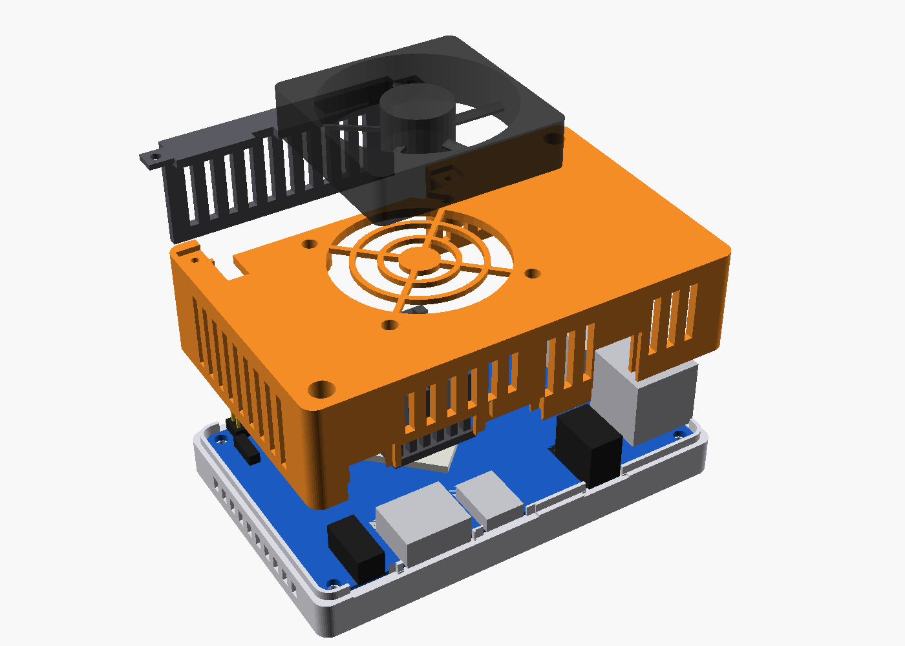

- **Base**: 2 mm floor with slots, 4 posts 5 mm high under the board holes, walls up to the
  board's top surface and a thin locking rim. The board lies on top; connectors that stick out
  past the edge pass over the walls. The floor has holes to the **Reset** and **Recovery**
  buttons (press with a paper clip), labelled RST and REC. At the back there is a cut-out for
  the **microSD** card with a fingernail notch.
- **Lid**: 2 mm top with walls. The connector cut-outs are open at the bottom, so the lid goes
  on from above without catching on the board.
- **Rear opening over the 40-pin header** — open from the top and the back. You can take the
  lid off **without unplugging** the UART adapter and the fan wires. The **LEDs** (they sit
  right in front of the header) are visible through the same opening, no light pipe needed.
  A separate window sits over the 3-pin debug UART at the left edge.
- **Header cover** (`gpio_cover`) closes this opening from the top and the back. It is held by
  two M2 self-tapping screws through «ears» that lie flush in pockets in the lid top. The cover
  top has a window over pins 1–14: Dupont plugs for UART (6, 8, 10), the fan (4, 6) and PWM (7)
  pass through it. There is also a cut-out for the fan wire from the groove, one over the LEDs,
  and exhaust slots in the back wall. Without wires use the closed `gpio_cover_solid`.
- **Fan** sits on top of the lid and blows inwards, onto the heatsink. The opening has a finger
  guard. Under the lid there are bosses with pockets for M3 nuts.
- **Exhaust**: slots in the left wall (above and below the board), in the back wall right of the
  header, in the front wall above the connectors, the rear opening and the shared USB/Ethernet
  window. The outlet area is larger than the fan area.
- **Two lid columns** (above the holes next to the audio jack and next to the single USB port)
  press the board onto the posts. A long M2.5 screw goes through the column and the board into
  the base post and holds everything at once.
- **Space for a PWM switch board**: two posts under the lid right of the header, above the Wi-Fi
  module, next to Ethernet. Board up to 16×18 mm, held by two M2 self-tapping screws. More in
  section 7.
- **Wire channel**: a groove in the lid top from the rear right corner of the fan to the header
  opening, opposite pins 4 and 6.

Section through the fan centre: 2.5 mm gap between the heatsink and the lid, connectors in their
cut-outs.

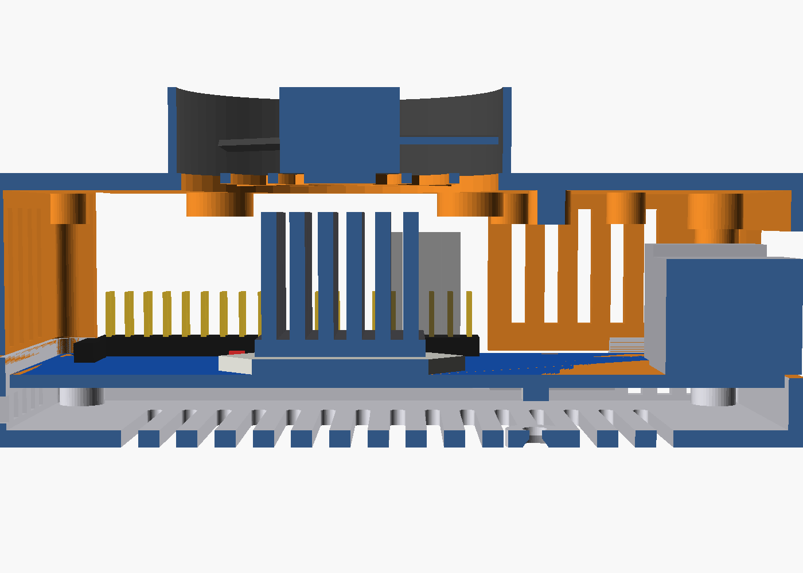

## 4. Printing

| Part | Orientation (already so in the STL) | Supports |
|------|-------------------------------------|----------|
| Base | floor on the bed | not needed |
| Lid | **top on the bed** (the grille is the first layers) | not needed |
| Heatsink mount | fan pad on the bed | not needed (funnel walls ≤ 47°) |
| Bridge mount | fan pad on the bed | not needed |
| Header cover | top on the bed (the wall stands vertically) | not needed |
| Template | as it lies | not needed |

- **Material**: **PETG**. Inside the case near the heatsink it gets to 50–60 °C, and PLA starts
  to deform at such temperatures. The heatsink mount (touches the heatsink) — only PETG, ABS
  or ASA.
- 0.2 mm layers, 0.4 nozzle, 3–4 perimeters (a 2 mm wall is 4–5 lines), 20–30 % infill.
- Bridges in the model are no longer than 2 mm (tops of the slots). Nut pockets and posts are
  open upwards.
- Fit clearances are 0.3 mm. If your printer over-extrudes, increase `CLR` in `opi4_case_lib.scad`.

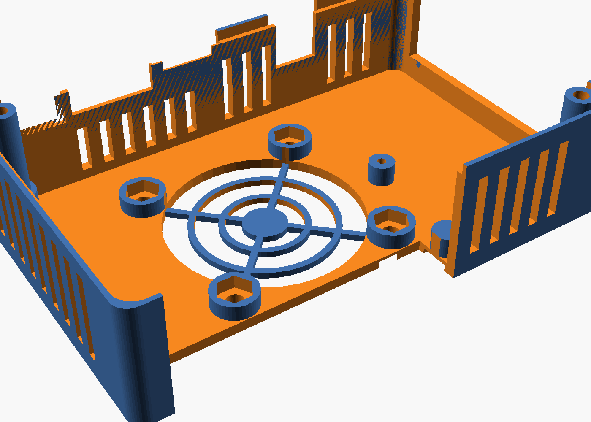

## 5. Fasteners

| Where | What | How many |
|-------|------|----------|
| Lid → board → base (columns) | **M2.5×25** screw (DIN 912 or ISO 7380), self-taps into the Ø2.2 post | 2 |
| The other two board holes (optional) | M2.5×5–6 into the base posts, if the head does not hit the USB stack or the header | 0–2 |
| 40×10 or 30×10 fan → lid | **M3×16** screw + M3 nut (in the pocket under the lid) | 4 + 4 |
| 30×7 fan → lid | M3×12–14 + M3 nut | 4 + 4 |
| PWM switch board | M2×5 self-tapping screw (or double-sided tape) | 2 |
| Header cover → lid | M2×6 self-tapping screw (into the boss under the lid top) | 2 |
| Feet | self-adhesive rubber feet | 4 |

- If you only have M2.5×30 screws, set `LID_SCREW_L = 30`: the counterbore disappears and the
  head rests on the lid.
- For frequent opening, brass M2.5 inserts (Ø3.5×4) are better. Set `INSERTS = true`: the posts
  become Ø7 with a Ø3.6 hole, and the inserts are melted in with a soldering iron.

**Heatsink mount**: 4 M3×14–16 self-tapping screws (or the screws that came with the fan) —
through the fan into the pad.

**Bridge mount**: 2 M2.5×6–8 screws from below through the board into the columns (Ø2.2 hole),
plus 4 M3×16 screws and 4 M3 nuts for the fan. If the board stands on male–female brass
standoffs, the standoff thread can go from below straight into the column.

## 6. Assembly

### Case, step by step

**Step 1. Base.** Stick the rubber feet underneath without covering the RST and REC holes. If you
use brass inserts (`INSERTS = true`), melt them into the posts with a soldering iron.

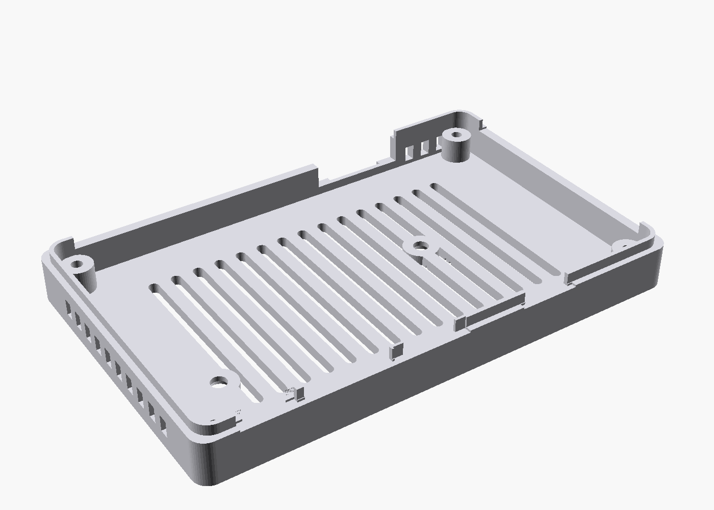

**Step 2. Board.** Put the board on the posts: HDMI to the front, header and microSD to the back.
The connectors that stick out past the edge rest over the walls.

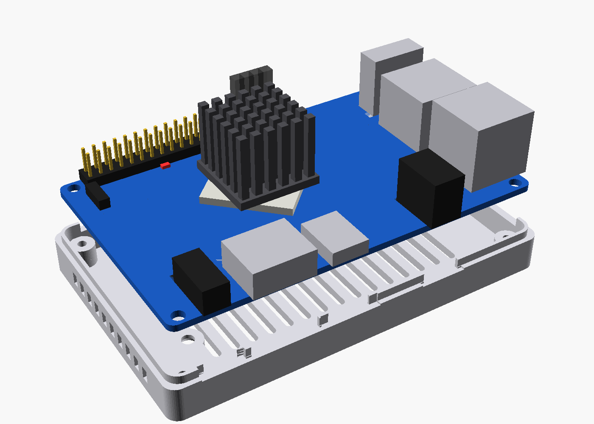

**Step 3. Fan on the lid.** Press 4 M3 nuts into the hex pockets under the lid (warming them with
a soldering iron helps). Put the fan on **label side down** (the label is the outlet side, it
must blow into the case), with the wire towards the rear right corner, to the groove. Screw it
on with four M3×16.

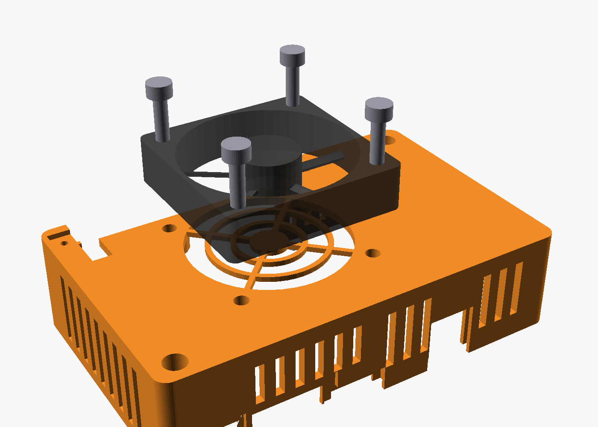

**Step 4. Lid.** Put the lid on from above: its skirt goes behind the base rim, the columns press
the board down. Tighten the two M2.5×25 screws in the counterbored corners. Do not overtighten:
the thread is in plastic.

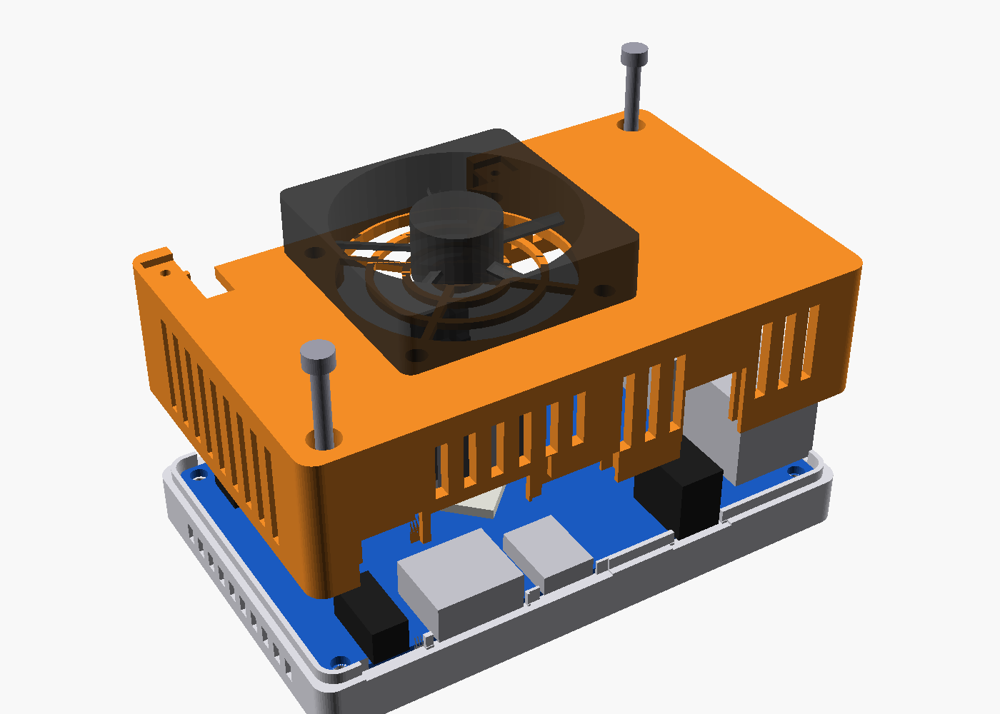

**Step 5. Wires and header cover.** Pass the Dupont wires through the cover window *before*
putting them on the pins: UART on 6, 8, 10, the fan on 4 and 6 (or 9/14), PWM on 7, see
section 7. Put the plugs on the pins through the open rear opening. Lay the fan wire into the
groove on the lid. Insert the cover from above and fix it with two M2×6 self-tapping screws
through the ears.

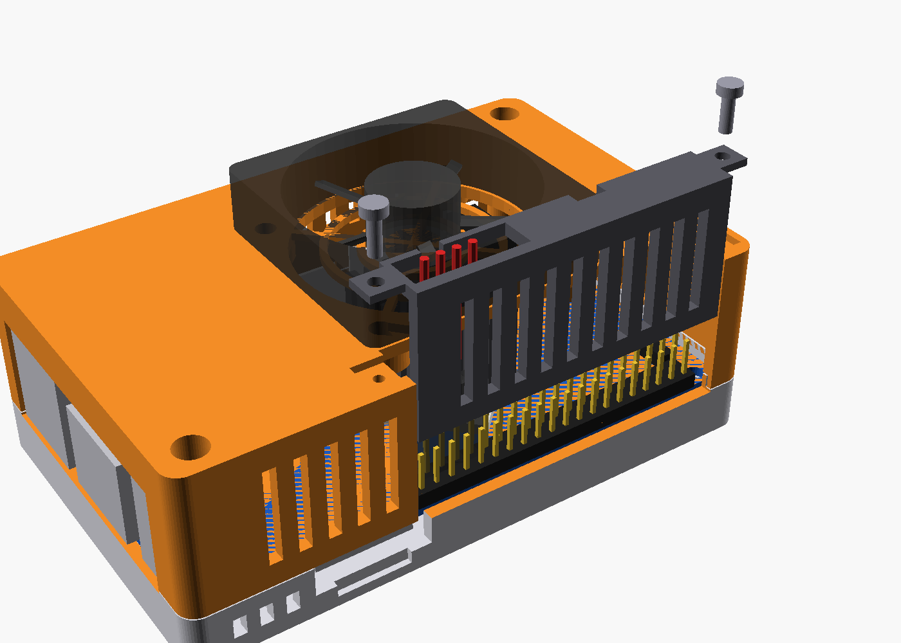

**Step 6. Done.** The LEDs are visible through the cover cut-out, Reset and Recovery are pressed
with a paper clip from below.

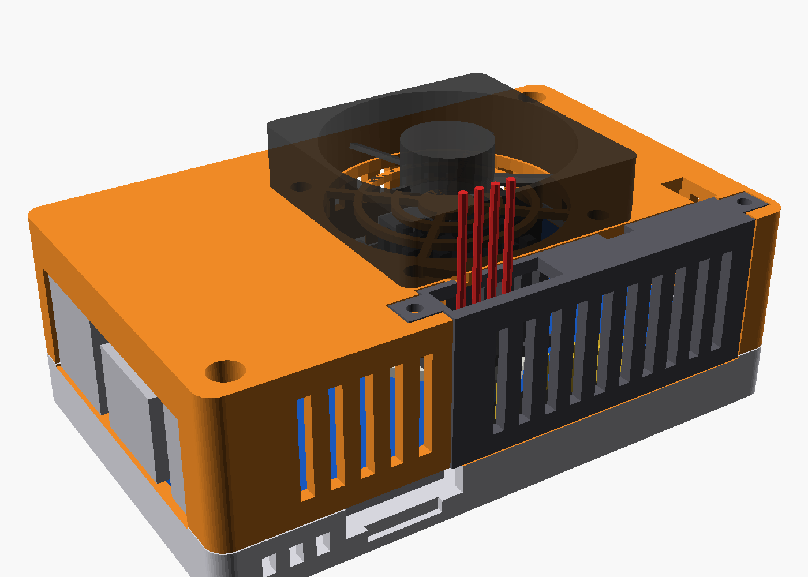

The Wi-Fi antenna can stay inside: plastic does not shield it. If you need an external SMA
antenna, set `ANT_HOLE = true`, and a Ø6.5 mm hole appears in the left wall.

### 40 mm mount without a case

- **On the heatsink** (`fan_mount_40_heatsink`) — like the 30 mm adapter in `../fan-mount`, but
  for 40 mm. Push the sleeve onto the heatsink all the way: the inner lip rests on the outer row
  of pins. If the heatsink is turned 45° together with the SoC, take `_rot45`: its sleeve is
  turned, while the fan pad stays parallel to the board edges. If it does not fit, take the
  `_loose` variant; if it wobbles, put a drop of hot glue on a corner. The fan is shifted 4.5 mm
  away from the header (towards HDMI), so the Dupont wires do not hit its frame.

  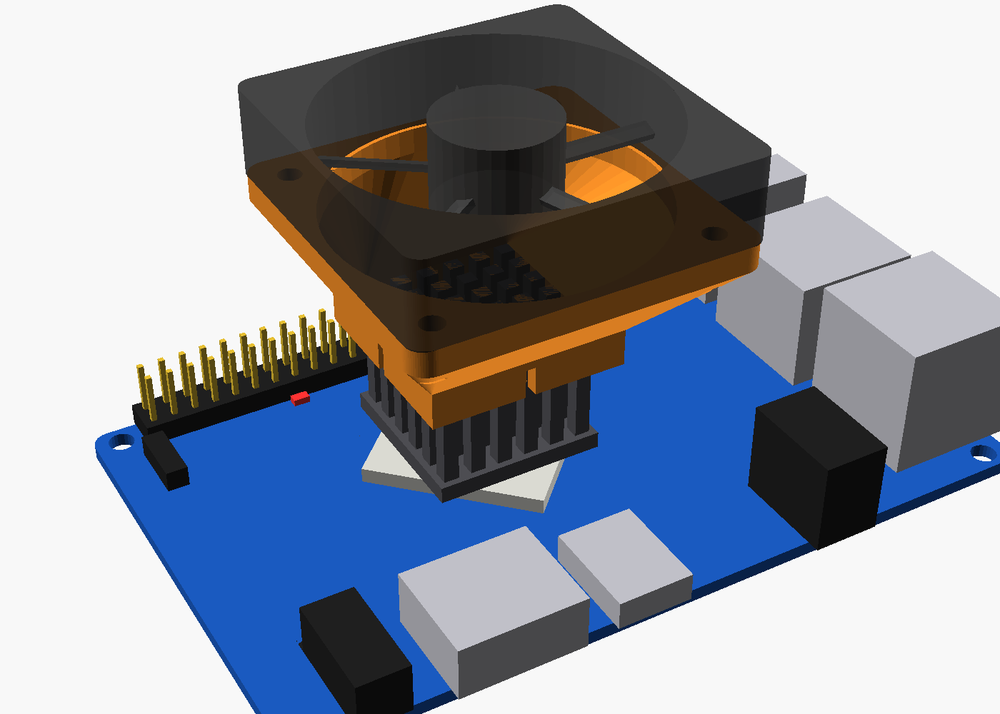

- **Bridge on the board holes** (`fan_mount_40_bridge`) — two columns on a diagonal: next to the
  audio jack and next to the single USB port. The fan hangs 3 mm above the heatsink and also
  cools the RAM, PMU and Wi-Fi. The columns are screwed on from below through the board.

  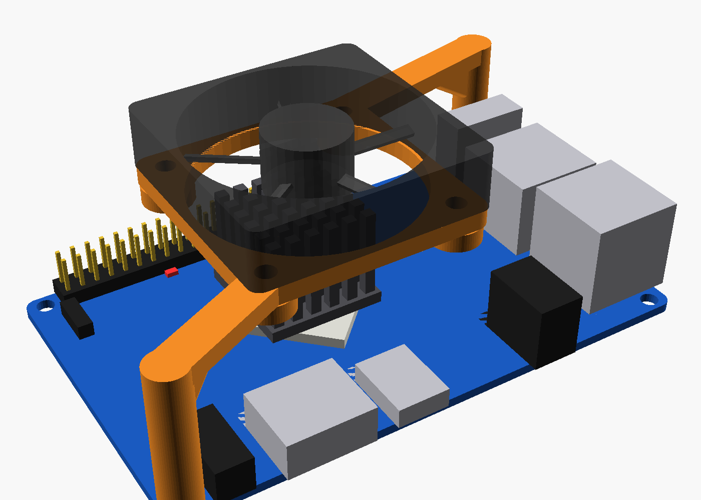

## 7. Connecting the fan

40-pin header. **Pin 1** is the square pad on the back of the board. It is in the row **at the
board edge**, at the end of the header **closer to USB and Ethernet**. Odd pins (1, 3, 5, 7 …)
are the edge row, even pins (2, 4, 6, 8, 10 …) the inner row.

```
                  ← to the left edge (cameras)      to USB / Ethernet →
  edge row:        39  …  11    9    7    5    3    1
                               GND? PWM1
  inner row:       40  …  12   10    8    6    4    2
                               RX   TX   GND   5V   5V
```

Check with a multimeter before connecting: pin 1 = 3.3 V, pins 2 and 4 = 5 V, pin 6 = GND.

**Without control** (the fan always runs):

- red (+) → **pin 4 (5 V)**;
- black (−) → **pin 6 (GND)**.

**Careful:** pin 1 (3.3 V) is right next to pin 4 diagonally. A short between 5 V and 3.3 V can
destroy the board. Connect the wires with the power off.

If pin 6 is already taken by the ground of a UART adapter (pins 6, 8, 10), a second wire will not
fit on the same pin. Then put the fan minus on another GND. On this header, like on a Raspberry
Pi, ground is usually pins **9, 14, 20, 25, 30, 34, 39**. Check the chosen pin against pin 6
before connecting.

Pins 4 and 6 can handle a 5 V / 0.1–0.2 A fan. A 5 V / 3 A power supply is enough for the board
with a fan.

**With PWM control** (pin 7 = PWM1 = GPIO4_C6, checked with an oscilloscope). Low-side switch on
a logic-level N-MOSFET: AO3400, SI2302 or IRLML2502. A 2N7002 does not open fully at 3.3 V on
the gate.

```
 pin 4 (+5 V) ──┬──────────────┐
                │              │
          (+) fan            diode 1N4148 / SS14
          (−)   │            (cathode to +5 V)
                ├──────────────┘
                D
 pin 7 ─[100 Ω]──┬─ G   AO3400 (N-MOSFET)
                 │  S
              [10 kΩ]
                 │  │
 GND ────────────┴──┘      (pin 6, 9 or 14)
```

The 10 kΩ between gate and ground keeps the switch off while pin 7 is not configured. So during
boot and if the software hangs, the fan **stops**. If you prefer the fan to run by default,
connect the 10 kΩ from the gate to pin 1 (3.3 V) instead of ground. Then the software has to
switch the fan off rather than on.

- A switch board up to 16×18 mm mounts on the posts under the lid (`KEY_POSTS`) with two M2×5
  self-tapping screws. Wires: from the fan through the header opening to the switch, from the
  switch three wires to pins 4, 7 and GND.
- Frequency: for a 2-wire fan 20–25 kHz (no whine, but smooth control only in a narrow range) or
  simply on/off by temperature. In the Android build PWM1 is already exported and available to
  apps: `/sys/class/pwm/pwmchip1/pwm0` (`period`, `duty_cycle`, `enable`).

## 8. Changing dimensions and rebuilding

1. Fix the parameters in `opi4_board.scad` (board) or `opi4_case_lib.scad` (case: walls,
   clearances, screws, options).
2. Check that nothing touches the board: open `check_fit.scad` and press F6. Only a flat «film»
   may remain where parts touch (posts, columns) — no volume.
3. Rebuild everything:

   ```bash
   bash render.sh "C:/path/to/openscad.com"
   ```

OpenSCAD 2021.01 portable (~22 MB, no installation needed):
<https://files.openscad.org/OpenSCAD-2021.01-x86-64.zip>. Or `winget install OpenSCAD.OpenSCAD`.

Useful parameters:

| Parameter | File | Meaning |
|-----------|------|---------|
| `HS_CLEAR` | case_lib | heatsink ↔ lid gap (2.5 mm) |
| `STANDOFF_H` | case_lib | post height (5 mm) |
| `GAP`, `CLR` | case_lib | board ↔ wall gap, fit clearance |
| `LID_SCREW_L`, `INSERTS` | case_lib | lid screw length, brass inserts |
| `FAN_GRILLE`, `NUT_TRAPS` | case_lib | grille, nut pockets |
| `FRONT_VENTS`, `SIDE_VENTS`, `FLOOR_VENTS` | case_lib | slots |
| `MERGE_R` | case_lib | one shared USB/Ethernet window on the right |
| `FAN_CY` | case_40/case_30 | fan position |
| `FIT` | fan_mount_40 | sleeve fit on the heatsink |

## 9. Where the dimensions come from

- 91 × 55.7 mm — official specification: [Orange Pi 4 wiki](http://www.orangepi.org/orangepiwiki/index.php/Orange_Pi_4).
- Everything else (holes, connectors, SoC, pin 1, buttons, LEDs) was taken from the official
  photos on the same wiki (≈ 7.6 px/mm).
- Connector heights are typical values for such parts, not measured.
- The official mechanical drawing is in the documentation archive on the
  [Orange Pi 4 downloads page](http://www.orangepi.org/html/hardWare/computerAndMicrocontrollers/service-and-support/Orange-pi-4.html)
  (Google Drive). If you have it, compare items 1–9 of section 2 against it.
