# Корпуса и крепление вентилятора для Orange Pi 4 (RK3399, v1.3)

*English version: [README.en.md](README.en.md)*

Корпус для 3D-печати под вентилятор **30×30** или **40×40 мм** и крепления вентилятора
без корпуса. Параметрические модели OpenSCAD и готовые STL.

> **Статус: бета.** Шаблон посадки и основание напечатаны и проверены на плате
> (отверстия и разъёмы совпали). Крышки, заглушка гребёнки и крепления 40 мм в текущей
> версии ещё не печатались. Перед печатью корпуса напечатайте шаблон (раздел 1).

Переходник 30 мм на радиатор без корпуса — в [../fan-mount](../fan-mount).

| Файл | Что это |
|------|---------|
| `opi4_board.scad` | модель платы: размеры, отверстия, разъёмы, SoC, радиатор, гребёнка. **Все неточные размеры — параметры наверху файла** |
| `opi4_case_lib.scad` | общий код корпуса: основание, крышка, шаблон для проверки |
| `case_30.scad` | корпус под вентилятор 30×30 |
| `case_40.scad` | корпус под вентилятор 40×40 (5 В, под полные частоты) |
| `fan_mount_40.scad` | крепление 40×40 без корпуса, 2 варианта: на радиатор и на отверстия платы |
| `gpio_cover.scad` | заглушка проёма гребёнки GPIO (подходит к обеим крышкам) |
| `check_fit.scad` | проверка, что детали не задевают модель платы |
| `render.sh` | пересобрать все STL и PNG |
| `stl/` | готовые STL, уже повёрнуты для печати |
| `png/` | превью и картинки сборки |

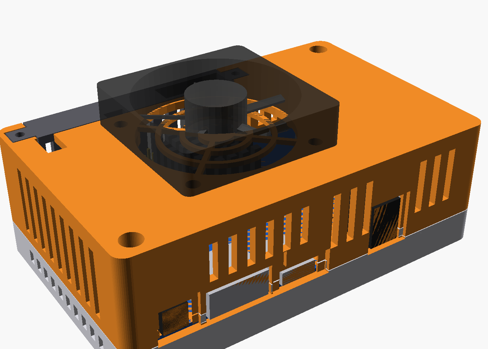

## 1. Что печатать

| Вариант | Детали |
|---------|--------|
| **Корпус под 40 мм** | `stl/case_base.stl` + `stl/case40_lid.stl` |
| **Корпус под 30 мм** | `stl/case_base.stl` + `stl/case30_lid.stl` |
| **Крепление 40 мм на радиатор** (без корпуса) | радиатор стоит ровно, стороны вдоль краёв платы: `stl/fan_mount_40_heatsink.stl` (зазор 0,20 мм) или `_loose` (0,35 мм); радиатор повёрнут на 45° вместе с SoC: `stl/fan_mount_40_heatsink_rot45.stl` или `_rot45_loose` |
| **Крепление 40 мм на отверстия платы** (без корпуса) | `stl/fan_mount_40_bridge.stl` |
| **Заглушка гребёнки GPIO** (к любой крышке) | `stl/gpio_cover.stl` — с окном для проводов на пины 1–14; `stl/gpio_cover_solid.stl` — глухая |
| **Сначала — шаблон** | `stl/fit_template.stl` (~10 мин, 4 г) |

Основание у обоих корпусов одно и то же: печатаете одно основание и меняете крышки.

Масса (PETG/PLA): основание ≈ 17 г, крышка ≈ 21 г, заглушка ≈ 3 г, крепление ≈ 6–8 г.

### Сначала напечатайте шаблон

Размеры сняты с официальных фото, точность около ±0,5 мм. Чтобы не тратить 4 часа на корпус вслепую, напечатайте `fit_template.stl`: рамка по контуру платы, четыре стойки со штырями и язычки напротив каждого разъёма.

1. Положите плату на шаблон, штыри должны войти в крепёжные отверстия без усилия.
2. Язычки по краям должны быть точно под разъёмами: аудио, HDMI, USB-C, DC спереди; USB-стек, Ethernet, USB2 справа; microSD сзади.
3. Крестик и квадрат 20×20 показывают, где модель считает центр SoC и радиатор. Посмотрите на плату сбоку: радиатор должен быть над квадратом. Сам SoC на плате стоит под 45°. Если радиатор приклеен так же, поставьте `HS_ROT = 45`, и квадрат на шаблоне тоже повернётся.

Если что-то не совпало, поправьте параметр в `opi4_board.scad` (см. раздел 2) и пересоберите STL (раздел 8).

## 2. Что проверить штангенциркулем до печати

Отсчёт ведётся от угла платы, где сходятся **передняя кромка** (HDMI, аудио, USB-C, DC) и **левая кромка** (шлейфы камер). X — вдоль длинной стороны (91 мм), Y — вдоль короткой (55,7 мм).

| # | Что мерить | Параметр | Сейчас | Насколько важно |
|---|------------|----------|--------|-----------------|
| 1 | Межцентровое расстояние отверстий по длине / по ширине | `HOLE_IN_X`, `HOLE_IN_Y` | 85,0 / 51,0 мм (центр 3,0 мм от короткой кромки, 2,35 мм от длинной) | **критично** |
| 2 | Диаметр крепёжных отверстий | `HOLE_D` | 3,0 | важно |
| 3 | Центр радиатора от левой и от передней кромки; повёрнут ли он на 45° | `HS_X`, `HS_Y` (и `SOC_X`, `SOC_Y`), `HS_ROT` | 38,8 / 33,1; 0° | важно для крепления на радиатор, корпусу всё равно |
| 4 | Высота от верха платы до верха радиатора | `SOC_H + HS_TAPE + HS_H` | 1,8 + 0,3 + 17 = 19,1 | **критично**: от неё высота крышки |
| 5 | Края разъёмов на передней кромке (X от левой кромки) | `CONNECTORS` | аудио 7,0–13,0; HDMI 17,4–32,2; USB-C 36,2–45,1; DC 61,1–69,0 | важно |
| 6 | Края разъёмов на правой кромке (Y от передней кромки) | `CONNECTORS` | USB-стек 4,5–20,3; Ethernet 23,6–39,7; USB2 43,4–49,6 | важно |
| 7 | Высота разъёмов над платой | `CONNECTORS` (5-й столбец) | USB-стек 16,0; USB2 15,0; Ethernet 13,6; DC 11,0; HDMI 6,5; аудио 6,0; USB-C 3,4 | важно |
| 8 | Вылет разъёмов за кромку | `CONNECTORS` (6-й столбец) | 0,5–2,0 | средне |
| 9 | microSD снизу: края слота (X) и толщина | `CONNECTORS`, строка `sd` | 57,2–73,0; 1,8 | средне |
| 10 | Самая высокая деталь снизу платы | `BOTTOM_PARTS_H` | 2,5 (стойки 5 мм) | средне |
| 11 | Пин 1 гребёнки: X его центра | `HDR_PIN1_X` | 55,1 | слабо: проём с запасом |
| 12 | Кнопки Reset и Recovery снизу (X, Y) | `BTN_RESET`, `BTN_RECOVER` | (61,8; 29,9) и (10,9; 16,1) | слабо: отверстие можно рассверлить |
| 13 | Светодиоды у гребёнки | `LED_X`, `LED_Y` | (24,2; 50,2) | слабо: видны через проём гребёнки |

Пункты 1, 4, 5–7 — главные. Остальное задано с запасом.

**Проверено шаблоном (16.11.2026):** отверстия (п. 1–2) и положения разъёмов вдоль кромок (п. 5, 6, 9) совпали с платой. Шаблон не проверяет высоты: пункты 4, 7, 10 по-прежнему по типовым значениям. Центр SoC совпал с крестиком; сам SoC повёрнут на 45°. Корпусам поворот радиатора не важен: обе крышки проверены и с радиатором под 0°, и под 45°.

ИК-приёмника на Orange Pi 4 v1.3 нет (на фото его нет). Если припаяете свой, включите `IR_ENABLE = true` в `opi4_case_lib.scad` и задайте `IR_X`, `IR_Y` в `opi4_board.scad`.

## 3. Как устроен корпус

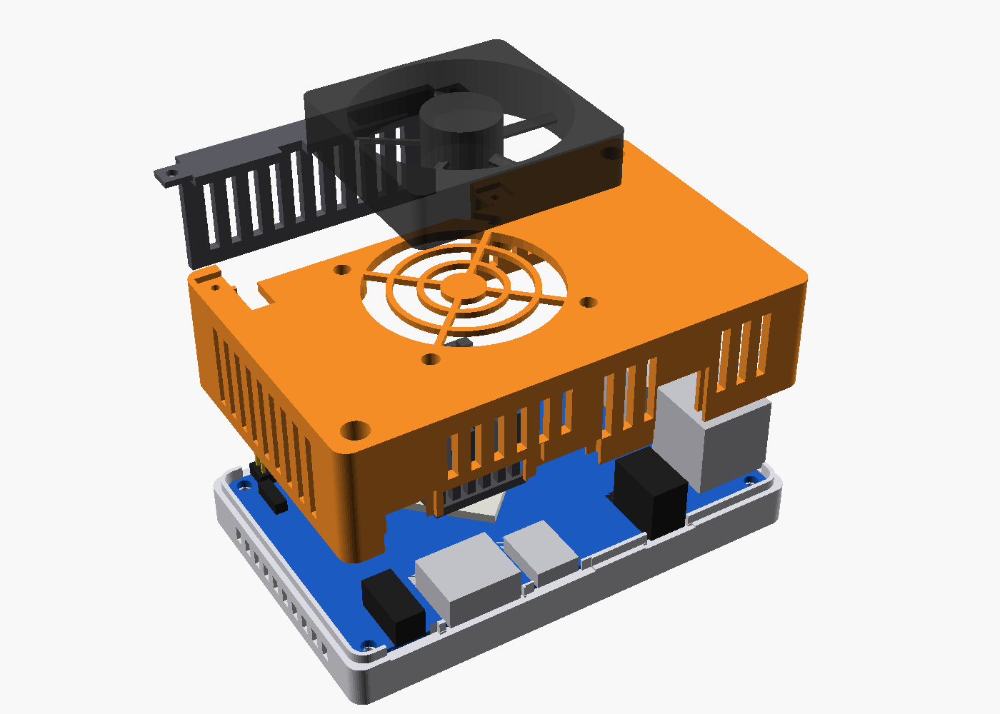

- **Основание**: дно 2 мм со щелями, 4 стойки высотой 5 мм под отверстия платы, стенки до уровня верхней поверхности платы и тонкий бортик-замок. Плата кладётся сверху; разъёмы, выступающие за кромку, проходят над стенками. В дне есть отверстия к кнопкам **Reset** и **Recovery** (нажимать скрепкой) с подписями RST и REC. Сзади вырез под **microSD** с выемкой под ноготь.
- **Крышка**: верх 2 мм со стенками. Вырезы под разъёмы открыты вниз, поэтому крышка надевается сверху, а плата не мешает.
- **Задний проём над гребёнкой 40 pin** — сквозной, сверху и сзади. Крышку можно снять, **не отключая** переходник UART и провода вентилятора. Через этот же проём видны **светодиоды** (они стоят прямо перед гребёнкой), световод не нужен. Отдельное окно над 3-контактным отладочным UART у левой кромки.
- **Заглушка гребёнки** (`gpio_cover`) закрывает этот проём сверху и сзади. Она держится двумя саморезами M2 через «ушки», которые лежат заподлицо в карманах верха крышки. В верху заглушки окно над пинами 1–14: Dupont-разъёмы UART (6, 8, 10), вентилятора (4, 6) и ШИМ (7) проходят сквозь него. Ещё есть вырез под провод вентилятора из канавки и вырез над светодиодами, а в задней стенке — щели на выдув. Без проводов можно поставить глухой вариант `gpio_cover_solid`.
- **Вентилятор** стоит на крышке снаружи и дует внутрь, на радиатор. В отверстии решётка от пальцев. Под крышкой бобышки с карманами под гайки M3.
- **Выдув**: щели в левой стенке (выше и ниже платы), в задней стенке справа от гребёнки, в передней стенке над разъёмами, задний проём и общее окно USB/Ethernet. Площадь выхода больше площади вентилятора.
- **Две колонны крышки** (над отверстиями у аудиоразъёма и у одиночного USB) прижимают плату к стойкам. Длинный винт M2.5 проходит через колонну и плату в стойку основания и держит сразу всё.
- **Место под плату ключа ШИМ**: две стойки под крышкой справа от гребёнки, над Wi-Fi-модулем, рядом с Ethernet. Плата до 16×18 мм, крепится двумя саморезами M2. Подробнее в разделе 7.
- **Канал для проводов**: канавка в верхе крышки от заднего правого угла вентилятора к проёму гребёнки, напротив пинов 4 и 6.

Разрез по центру вентилятора: зазор между радиатором и крышкой 2,5 мм, разъёмы в вырезах.

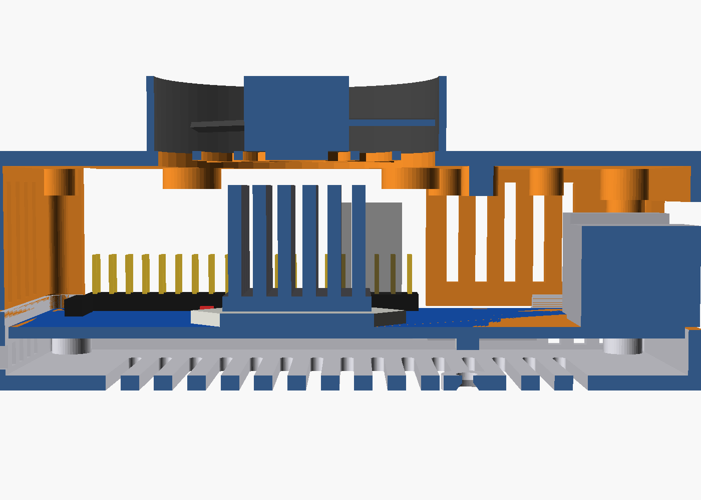

## 4. Печать

| Деталь | Ориентация (в STL уже так) | Поддержки |
|--------|---------------------------|-----------|
| Основание | дном на стол | не нужны |
| Крышка | **верхом на стол** (решётка — первые слои) | не нужны |
| Крепление на радиатор | площадкой вентилятора на стол | не нужны (стенки воронки ≤ 47°) |
| Крепление-мостик | площадкой вентилятора на стол | не нужны |
| Заглушка гребёнки | верхом на стол (стенка стоит вертикально) | не нужны |
| Шаблон | как лежит | не нужны |

- **Пластик**: **PETG**. Внутри корпуса у радиатора бывает 50–60 °C, а PLA при таких температурах начинает «плыть». Крепление на радиатор (касается радиатора) — только PETG, ABS или ASA.
- Слой 0,2 мм, сопло 0,4, 3–4 периметра (стенка 2 мм — это 4–5 линий), заполнение 20–30 %.
- Мостики в модели не длиннее 2 мм (верх щелей). Карманы под гайки и стойки открыты вверх.
- Зазоры посадок 0,3 мм. Если принтер «толстит», увеличьте `CLR` в `opi4_case_lib.scad`.

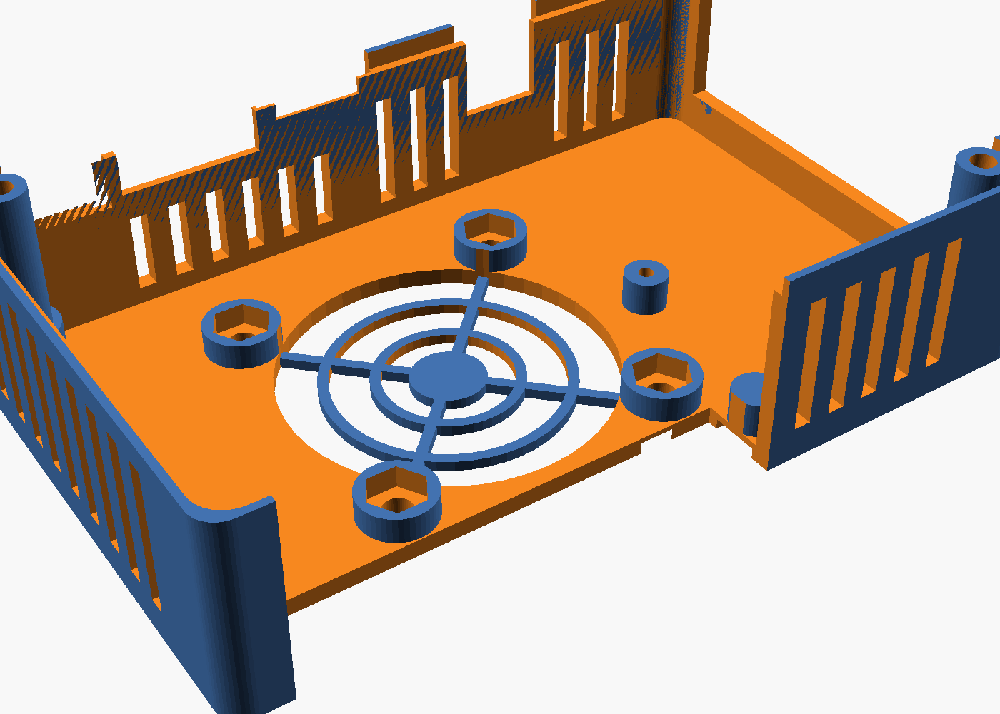

## 5. Крепёж

| Где | Что | Сколько |
|-----|-----|---------|
| Крышка → плата → основание (колонны) | винт **M2.5×25** (DIN 912 или ISO 7380), вкручивается саморезом в стойку Ø2,2 | 2 |
| Два других отверстия платы (по желанию) | M2.5×5–6 в стойки основания, если головка не упирается в USB-стек или гребёнку | 0–2 |
| Вентилятор 40×10 или 30×10 → крышка | винт **M3×16** + гайка M3 (в карман под крышкой) | 4 + 4 |
| Вентилятор 30×7 → крышка | M3×12–14 + гайка M3 | 4 + 4 |
| Плата ключа ШИМ | саморез M2×5 (или двусторонний скотч) | 2 |
| Заглушка гребёнки → крышка | саморез M2×6 (в бобышку под верхом крышки) | 2 |
| Ножки | резиновые самоклеящиеся | 4 |

- Если есть только винты M2.5×30, поставьте `LID_SCREW_L = 30`: цековка исчезнет, головка ляжет на крышку.
- Под частое вскрытие лучше латунные вставки M2.5 (Ø3,5×4). Поставьте `INSERTS = true`: стойки станут Ø7 с отверстием Ø3,6, вставки вплавляются паяльником.

**Крепление на радиатор**: 4 самореза M3×14–16 (или винты из комплекта вентилятора) — через вентилятор в площадку.

**Крепление-мостик**: 2 винта или самореза M2.5×6–8 снизу через плату в колонны (отверстие Ø2,2), а также 4 винта M3×16 и 4 гайки M3 для вентилятора. Если плата стоит на латунных стойках «папа–мама», можно вкрутить резьбу стойки снизу прямо в колонну.

## 6. Сборка

### Корпус (по шагам)

**Шаг 1. Основание.** Наклейте снизу резиновые ножки, не закрывая отверстия RST и REC. Если стоят латунные вставки (`INSERTS = true`), вплавьте их в стойки паяльником.

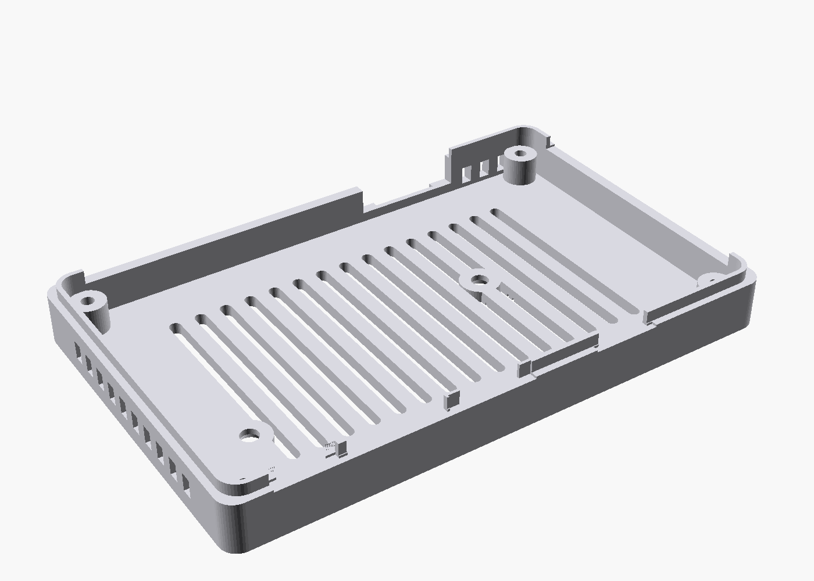

**Шаг 2. Плата.** Положите плату на стойки: HDMI вперёд, гребёнка и microSD назад. Разъёмы, выступающие за кромку, ложатся над стенками.

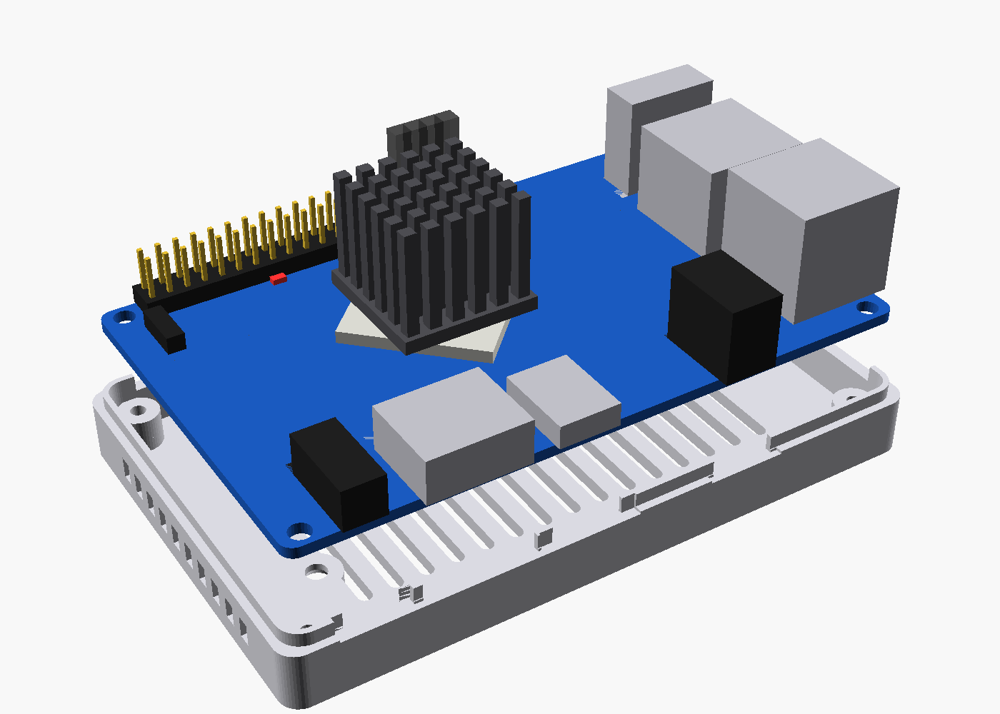

**Шаг 3. Вентилятор на крышку.** Вдавите 4 гайки M3 в шестигранные карманы под крышкой (можно подогреть паяльником). Поставьте вентилятор **наклейкой вниз** (наклейка — сторона выдува, он должен дуть в корпус), проводом к заднему правому углу, к канавке. Прикрутите четырьмя M3×16.

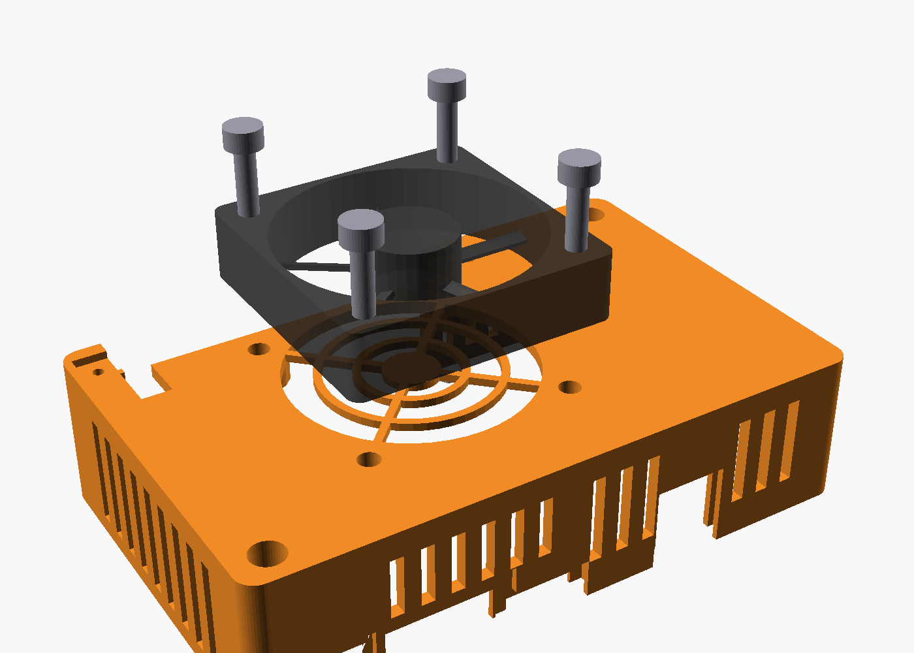

**Шаг 4. Крышка.** Наденьте крышку сверху: юбка ляжет за бортик основания, колонны прижмут плату. Затяните два винта M2.5×25 в углах с цековками. Не перетягивайте: резьба в пластике.

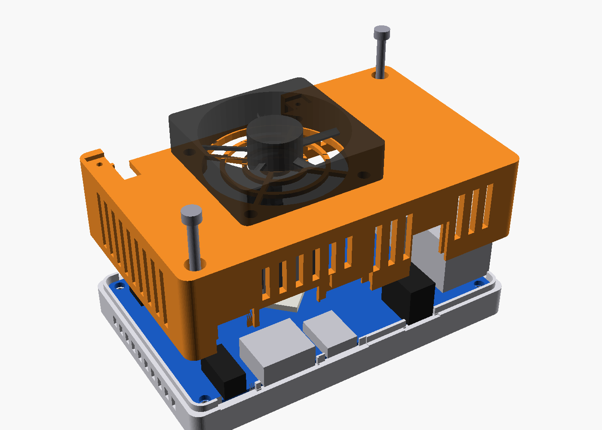

**Шаг 5. Провода и заглушка гребёнки.** Пропустите Dupont-провода через окно заглушки *до того*, как надеть их на пины: UART на 6, 8, 10, вентилятор на 4 и 6 (или 9/14), ШИМ на 7, см. раздел 7. Наденьте разъёмы на пины через открытый задний проём. Провод вентилятора уложите в канавку на крышке. Вставьте заглушку сверху и прикрутите двумя саморезами M2×6 через ушки.

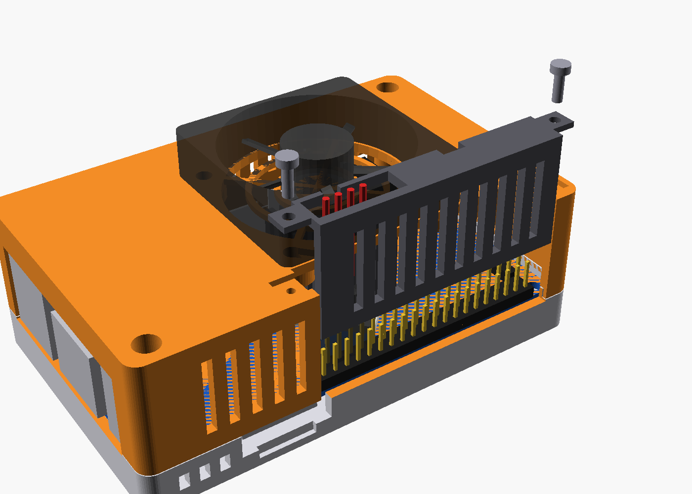

**Шаг 6. Готово.** Светодиоды видны через вырез заглушки, Reset и Recovery нажимаются скрепкой снизу.

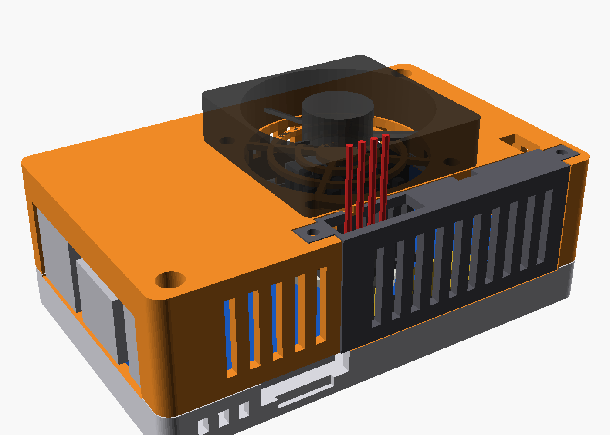

Антенну Wi-Fi можно оставить внутри: пластик её не экранирует. Если нужна выносная SMA-антенна, поставьте `ANT_HOLE = true`, и в левой стенке появится отверстие Ø6,5 мм.

### Крепление 40 мм без корпуса

- **На радиатор** (`fan_mount_40_heatsink`) — как прежний переходник из `../fan-mount`, но под 40 мм. Наденьте гильзу на радиатор до упора: внутренний бортик ляжет на крайний ряд игл. Если радиатор повёрнут на 45° вместе с SoC, берите `_rot45`: у него гильза повёрнута, а площадка вентилятора по-прежнему параллельна краям платы. Если не налезает, возьмите вариант `_loose`; если болтается — капля термоклея на угол. Вентилятор сдвинут на 4,5 мм от гребёнки (к HDMI), чтобы провода Dupont не упирались в его рамку.

  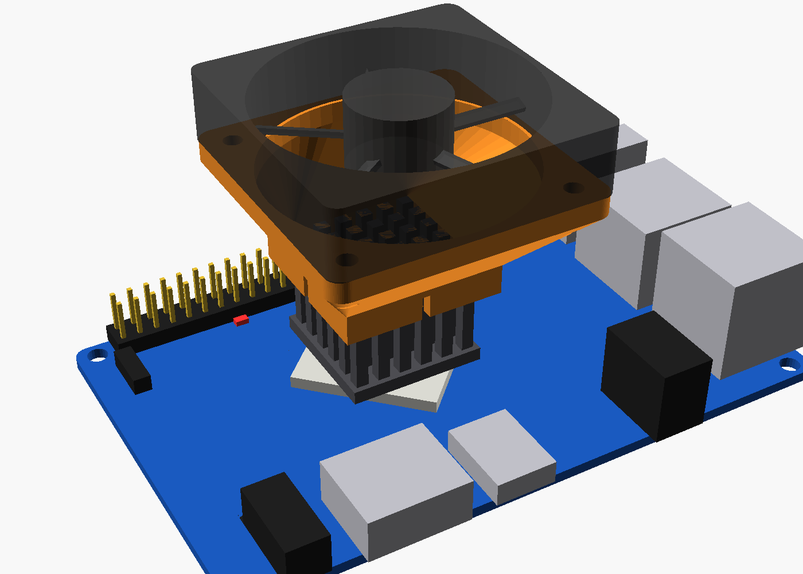

- **Мостик на отверстия платы** (`fan_mount_40_bridge`) — две колонны по диагонали: у аудиоразъёма и у одиночного USB. Вентилятор висит в 3 мм над радиатором и обдувает ещё память, PMU и Wi-Fi. Колонны прикручиваются снизу через плату.

  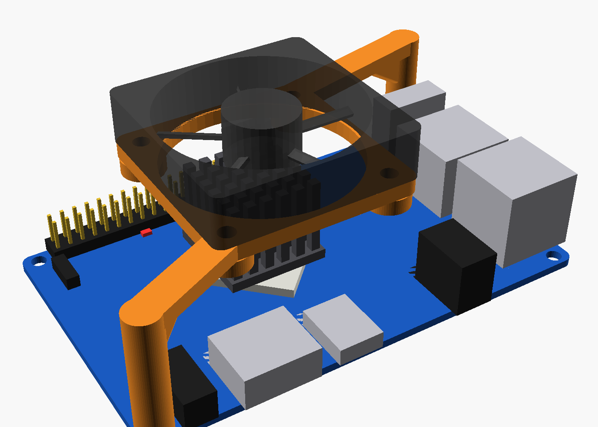

## 7. Подключение вентилятора

Гребёнка 40 pin. **Пин 1** — квадратная площадка на обороте платы. Он в ряду **у края платы**, на конце гребёнки, **ближнем к USB и Ethernet**. Нечётные пины (1, 3, 5, 7 …) — ряд у края, чётные (2, 4, 6, 8, 10 …) — внутренний ряд.

```
                  ← к левой кромке (камеры)      к USB / Ethernet →
  ряд у края:      39  …  11    9    7    5    3    1
                               GND? PWM1
  внутренний ряд:  40  …  12   10    8    6    4    2
                               RX   TX   GND   5V   5V
```

Перед подключением прозвоните мультиметром: пин 1 = 3,3 В, пины 2 и 4 = 5 В, пин 6 = GND.

**Без управления** (вентилятор крутится всегда):

- красный (+) → **пин 4 (5 В)**;
- чёрный (−) → **пин 6 (GND)**.

**Осторожно:** пин 1 (3,3 В) стоит по диагонали рядом с пином 4. Замыкание 5 В на 3,3 В может
убить плату. Подключайте провода при выключенном питании.

Если на пине 6 уже сидит земля переходника UART (пины 6, 8, 10), второй провод на тот же пин не наденется. Тогда минус вентилятора — на другой GND. На этой гребёнке, как у Raspberry Pi, землёй обычно бывают пины **9, 14, 20, 25, 30, 34, 39**. Прозвоните выбранный пин с пином 6 перед подключением.

Вентилятор 5 В / 0,1–0,2 А пины 4 и 6 выдержат. Блок питания 5 В / 3 А для платы с вентилятором подходит.

**С управлением ШИМ** (позже, пин 7 = PWM1 = GPIO4_C6, проверено осциллографом). Ключ по минусу на N-MOSFET с логическим уровнем: AO3400, SI2302 или IRLML2502. 2N7002 при 3,3 В на затворе открывается не полностью.

```
 пин 4 (+5 В) ──┬──────────────┐
                │              │
          (+) вентилятор     диод 1N4148 / SS14
          (−)   │            (катод к +5 В)
                ├──────────────┘
                D
 пин 7 ─[100 Ом]─┬─ G   AO3400 (N-MOSFET)
                 │  S
              [10 кОм]
                 │  │
 GND ────────────┴──┘      (пин 6, 9 или 14)
```

10 кОм между затвором и землёй держат ключ закрытым, пока пин 7 не настроен. Значит, при загрузке и при зависании ПО вентилятор **стоит**. Если надёжнее, чтобы он по умолчанию крутился, подключите 10 кОм от затвора к пину 1 (3,3 В) вместо земли. Тогда ПО должно будет выключать вентилятор, а не включать.

- Плата ключа до 16×18 мм крепится на стойки под крышкой (`KEY_POSTS`) двумя саморезами M2×5. Провода: от вентилятора через проём гребёнки к ключу, от ключа три провода на пины 4, 7 и GND.
- Частота: для 2-проводного вентилятора — 20–25 кГц (без писка, но плавная регулировка только в узком диапазоне) или просто вкл/выкл по температуре. В сборке Android PWM1 уже экспортирован и доступен приложениям: `/sys/class/pwm/pwmchip1/pwm0` (`period`, `duty_cycle`, `enable`).

## 8. Как изменить размеры и пересобрать

1. Поправьте параметры в `opi4_board.scad` (плата) или `opi4_case_lib.scad` (корпус: стенки, зазоры, винты, опции).
2. Проверьте, что ничего не задевает плату: откройте `check_fit.scad`, нажмите F6. Должна остаться только плоская «плёнка» в местах касания (стойки, колонны) — ни одного объёма.
3. Пересоберите всё:

   ```bash
   bash render.sh "C:/путь/к/openscad.com"
   ```

OpenSCAD 2021.01 portable (~22 МБ, установка не нужна): <https://files.openscad.org/OpenSCAD-2021.01-x86-64.zip>. Можно и через `winget install OpenSCAD.OpenSCAD`.

Полезные параметры:

| Параметр | Файл | Смысл |
|----------|------|-------|
| `HS_CLEAR` | case_lib | зазор радиатор ↔ крышка (2,5 мм) |
| `STANDOFF_H` | case_lib | высота стоек (5 мм) |
| `GAP`, `CLR` | case_lib | зазор плата ↔ стенка, зазор посадок |
| `LID_SCREW_L`, `INSERTS` | case_lib | длина винтов крышки, латунные вставки |
| `FAN_GRILLE`, `NUT_TRAPS` | case_lib | решётка, карманы под гайки |
| `FRONT_VENTS`, `SIDE_VENTS`, `FLOOR_VENTS` | case_lib | щели |
| `MERGE_R` | case_lib | одно окно под USB/Ethernet справа |
| `FAN_CY` | case_40/case_30 | положение вентилятора |
| `FIT` | fan_mount_40 | посадка гильзы на радиатор |

## 9. Откуда размеры

- 91 × 55,7 мм — официальная спецификация: [вики Orange Pi 4](http://www.orangepi.org/orangepiwiki/index.php/Orange_Pi_4).
- Остальное (отверстия, разъёмы, SoC, пин 1, кнопки, светодиоды) снято с официальных фото этой же вики (≈ 7,6 пикс/мм).- Высоты разъёмов — типовые значения для таких деталей, они не замерены.
- Официальный механический чертёж лежит в архиве документации на [странице загрузок Orange Pi 4](http://www.orangepi.org/html/hardWare/computerAndMicrocontrollers/service-and-support/Orange-pi-4.html) (Google Drive). Если он у вас есть, сверьте с ним пункты 1–9 раздела 2.
